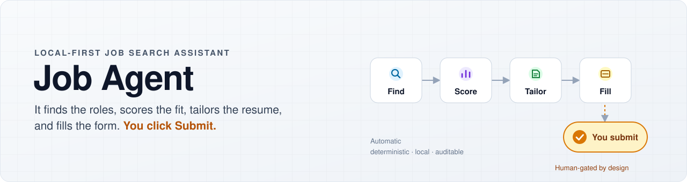
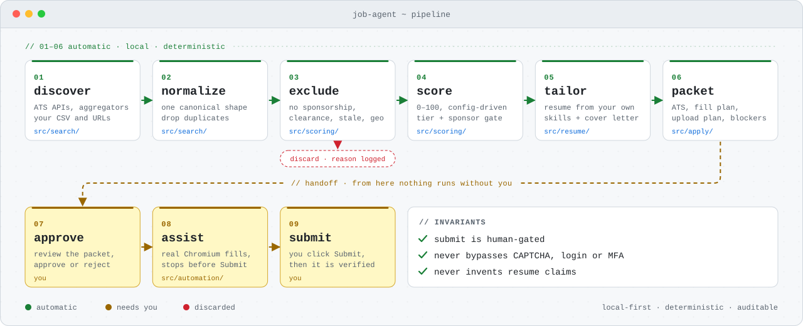
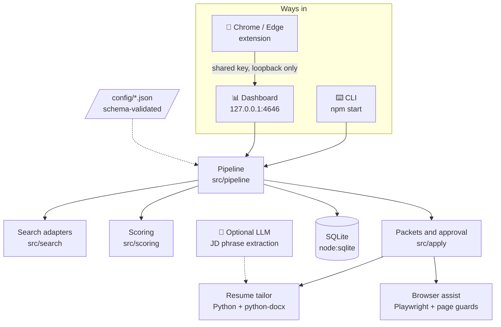
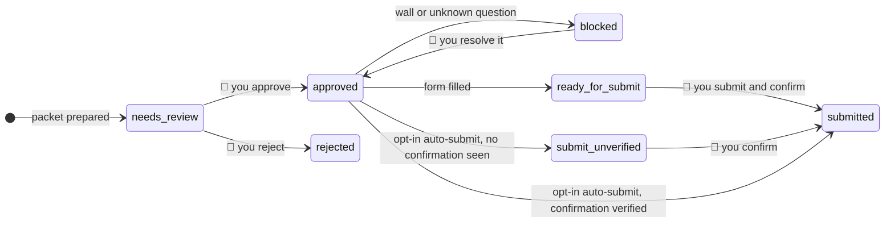
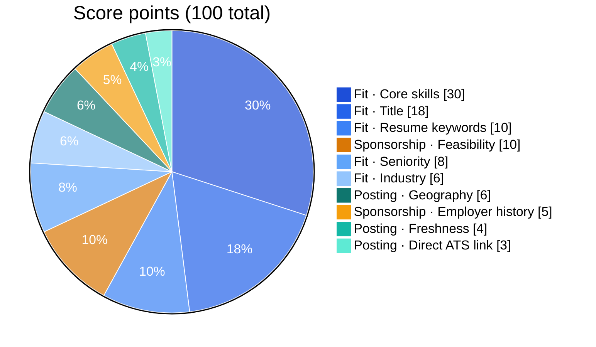
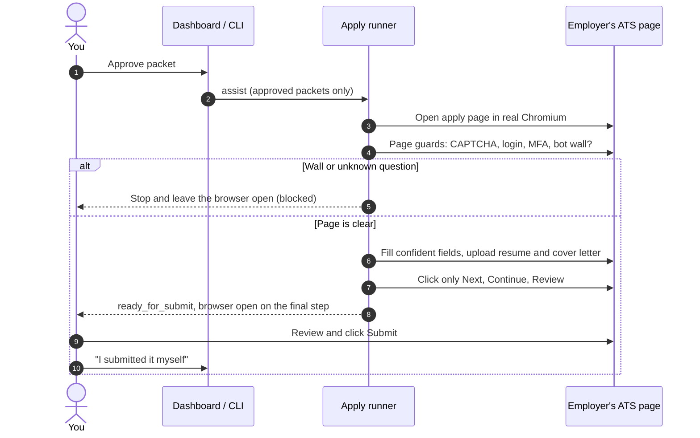
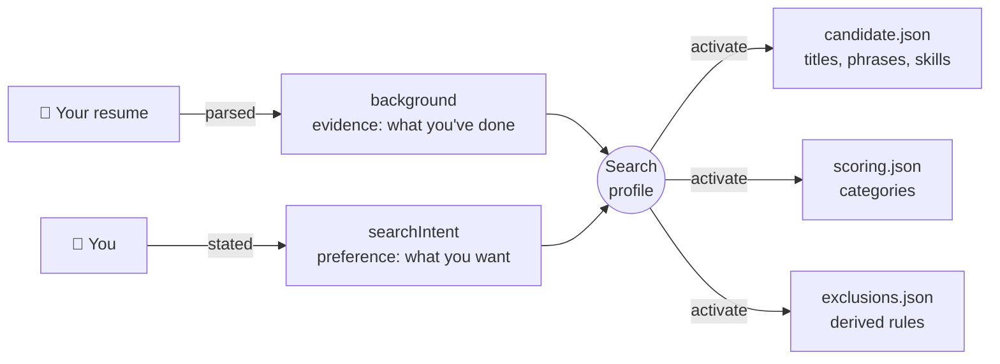

<div align="center">

<picture>
  <source media="(prefers-color-scheme: dark)" srcset="docs/assets/hero-dark.svg">
  
</picture>

<br>

[](https://github.com/AtreshSoma/JobAgent/actions/workflows/ci.yml)


[](LICENSE)

**[Quick start](#-quick-start)** · **[How it works](#-how-it-works)** · **[Safety model](#-safety-model)** · **[Dashboard](#-the-dashboard)** · **[Commands](#-command-cheat-sheet)** · **[Full User Guide](docs/USER_GUIDE.md)**

</div>

---

**Job Agent** is a local-first job search assistant. It discovers postings from public job-board APIs, scores each one against your profile with a deterministic, explainable model, and turns every strong match into a reviewable **application packet**: a tailored resume, a cover letter, the detected applicant tracking system (ATS), and a field-by-field fill plan.

Approve a packet and the agent opens the application in a real browser, fills it in, uploads your documents, and **stops before the final Submit**. Everything runs on your machine. The dashboard listens only on `127.0.0.1`, and your profile and answers stay in gitignored local files.

> [!IMPORTANT]
> **You stay in control of every application.** The agent fills and uploads, then hands the browser back to you. The single automated submit path requires your opt-in for that specific run, a clean form, a supported ATS, and an unused daily cap, and it records a job as applied only after the submission is **verified**. See the [Safety model](#-safety-model).

## ✨ Highlights

<table>
<tr>
<td width="33%" valign="top">

### 🔎 Finds roles you'd miss
Searches public ATS APIs (Greenhouse, Lever, Ashby, Workday, SmartRecruiters, Rippling, Oracle, iCIMS and more), plus **keyless cross-company search** that turns up employers you've never heard of. No API key needed to start.

</td>
<td width="33%" valign="top">

### 📊 Scores with reasons
Every job gets a 0–100 score from weighted, config-driven categories, with the matched skills, the missing ones, and a sponsorship verdict. The same inputs always give the same score.

</td>
<td width="33%" valign="top">

### 📝 Tailors without inventing
Reorders and emphasizes what your master resume **already says**, keeps it to two pages, and drafts a 180–260 word cover letter. It never adds a skill, title, or claim you don't have.

</td>
</tr>
<tr>
<td valign="top">

### 🤖 Fills the form for you
Detects the ATS, fills the fields it's confident about, uploads the right document into the right slot, and clicks only Next / Continue / Review.

</td>
<td valign="top">

### 🛡️ Never cuts corners
No CAPTCHA solving, no login-wall bypass, no stealth browsing. Legal, visa, and sponsorship questions are never guessed. They come back to you.

</td>
<td valign="top">

### 👤 Works for any profession
Search profiles separate **what you've done** (from your resume) from **what you want next** (from you). They cover about 26 occupational families, all configured in data rather than code.

</td>
</tr>
</table>

## 🔄 How it works

<div align="center">
<picture>
  <source media="(prefers-color-scheme: dark)" srcset="docs/assets/pipeline-dark.svg">
  
</picture>
</div>

| Stage | What happens | Where |
| --- | --- | --- |
| **Discover** | Calls public ATS APIs, parses JSON-LD from public job pages, imports your CSV and URL lists | `src/search/` |
| **Filter** | Drops duplicates, stale postings, and hard disqualifiers (no sponsorship, clearance, wrong seniority, wrong geography) | `src/search/`, `src/scoring/exclusionFilter.js` |
| **Score** | Weighted categories → 0–100 → tier, then the sponsorship gate | `src/scoring/` |
| **Prepare** | Tailored `.docx` resume (Python), cover letter, ATS detection, fill and upload plans | `src/resume/`, `src/apply/` |
| **Approve** | Packet waits as *needs review* until **you** approve it | `src/apply/approvalQueue.js` |
| **Assist** | Real Chromium opens the page, checks for walls, fills, uploads, stops before Submit | `src/automation/` |

<details>
<summary><b>🏗️ Architecture overview</b></summary>



</details>

## 🚀 Quick start

### 1. Check requirements

| Dependency | Version | Why |
| --- | :---: | --- |
| **Node.js** | **≥ 22.13** | The built-in `node:sqlite` store needs no flag from 22.13. CI tests 22.x and 24.x |
| **Python** | **3.12** | Resume tailoring through `python-docx` |
| **Playwright Chromium** | latest | Browser-assisted form filling (a separate download) |
| Microsoft Word | *optional* | Only for `docx2pdf` PDF export |

### 2. Install

```bash
npm ci                             # Node dependencies, pinned by package-lock.json
npx playwright install chromium    # the browser itself (npm ci does not fetch it)
npm run setup                      # create your personal config from the examples (never overwrites)
cp .env.example .env               # DRY_RUN needs no secrets
```

<details>
<summary><b>🐍 Python setup (resume tailoring)</b></summary>

Use a virtual environment. On macOS (Homebrew) and recent Debian/Ubuntu, `pip install` into the system Python fails with `externally-managed-environment` (PEP 668). Create a venv; don't use `--break-system-packages`.

```bash
python3 -m venv .venv
.venv/bin/pip install -r requirements.txt     # Windows: .venv\Scripts\pip install -r requirements.txt
echo "PYTHON=.venv/bin/python" >> .env         # Windows: PYTHON=.venv\Scripts\python.exe
```

Without Python, the agent still runs. It falls back to your untailored master resume and `npm run doctor` reports this as degraded.

</details>

### 3. Add your details

| What | Where | Notes |
| --- | --- | --- |
| 👤 **Profile** | `config/candidate.json`, `config/screening_answers.json`, `config/cover_letter.json` | Created by `npm run setup` with placeholder values. Nothing is prepared or submitted until you replace them. All gitignored. |
| 📄 **Master resume** | `resumes/base/MASTER_RESUME.docx` | Opened read-only. Tailored copies go to `resumes/output/`. |
| 🔗 **Job sources** | `config/jobboards.json` and optional `data/jobs_input/manual_jobs.csv` | Keyless search (`ats-search`) and the public ATS boards are on by default. |

### 4. Run the preflight check

```bash
npm run doctor     # one checklist: Node, SQLite, config schemas, profile, resume, Python, Chromium
```

| Result | Meaning |
|:--:|---|
| ❌ **Failure** | Blocks the run |
| ⚠️ **Degraded** | Works with a fallback. For example, no Python means the untailored resume is used |
| 📋 **Profile gap** | A missing field, such as a GitHub URL. Never invented. Fill it in yourself |

### 5. Launch

<table>
<tr><th width="50%">🖥️ Dashboard (recommended)</th><th width="50%">⌨️ Guided CLI</th></tr>
<tr valign="top">
<td>

| Platform | Command |
| --- | --- |
| Windows | double-click `start-job-agent.cmd` |
| PowerShell | `pwsh ./Start-JobAgent.ps1` |
| macOS / Linux | `./start-job-agent.sh` |
| Any | `npm run app` |

The launchers refresh dependencies when the lockfile changes, seed missing config, and open `http://127.0.0.1:4646`. Running one again reuses the open dashboard.

</td>
<td>

```bash
npm start
```

Finds, scores, and prepares in one pass. Then it lists the packets and asks which to approve: <kbd>a</kbd> for all, <kbd>n</kbd> for none, or a range like `1,3` or `1-2`. Finally it offers to open a browser and fill them, stopping before Submit.

</td>
</tr>
</table>

## 🔒 Safety model

This is the authoritative statement of what the agent will and won't do.

| | Rule |
|:--:|---|
| **1** | **Never bypasses** CAPTCHAs, bot protection, paywalls, login walls, MFA, rate limits, or any other platform security control. |
| **2** | **Prefers official surfaces**: public APIs, public job pages, ATS endpoints, and URLs you supply. |
| **3** | **No stealth.** No webdriver hiding, no fake user agents, no aggressive scraping. Requests carry a `User-Agent` that names this tool. |
| **4** | **Never fabricates** resume content, skills, certifications, history, salary, education, or immigration status. |
| **5** | **Human-gated submit.** Search, scoring, tailoring, and fill planning are automatic. The final Submit is not. |
| **6** | **Truthful work authorization.** The agent will not claim "no sponsorship required" for you. |
| **7** | **Ambiguity comes back to you.** Legal, immigration, salary, and relocation questions pause and ask. |
| **8** | **Every packet is reviewable** before anything happens. |

### Where every application can stop



<details>
<summary><b>✅ The gates on the one automated submit path</b></summary>

`applyRunner.tryAutoSubmit` is the only code that can click a final Submit. It's reachable through one local API route (`POST /api/auto-submit-batch`, which needs `confirmed: true`). No CLI command can submit. `npm run verify` asserts these gates are still in place.

- ✅ You opted in **for this specific run**
- ✅ Zero blockers, and every required field is filled
- ✅ Truthful sponsorship answers, none chosen live that you hadn't reviewed
- ✅ A confidently identified submit button
- ✅ Daily cap not reached (`MAX_APPLICATIONS_PER_DAY`, default **15**, counted in your time zone)
- ✅ A fixture-verified ATS: Greenhouse, Lever, Ashby, Workday, or SmartRecruiters. Unknown sites are fill-only
- ✅ The packet was approved **before** the run started and belongs to the active candidate

</details>

> [!WARNING]
> **A click is not proof.** A job counts as applied only when a confirmation page or a redirect with the form gone is seen. Otherwise it shows as `submit_unverified` for you to check. Questions phrased in the negative ("can you work here *without* sponsorship?") are never auto-answered, because inverting a stored answer would mean guessing about your immigration status.

More detail on fill-path guards is in the [User Guide → Safety model](docs/USER_GUIDE.md#-safety-model).

## 📊 Scoring

Each job is scored against **your** profile, not a fixed keyword list. With the shipped config, points split like this:



<p align="center"><b>🔵 Profile fit 72</b> &nbsp;·&nbsp; <b>🟠 Sponsorship 15</b> &nbsp;·&nbsp; <b>🟢 Posting 13</b></p>

| Tier | Score | What happens |
| --- | :---: | --- |
| 🟢 **Priority** | ≥ 85 | Prepared automatically |
| 🔵 **Apply** | ≥ 75 | Prepared automatically |
| 🟡 **Queue** | ≥ 60 | Prepared only if you pick it |
| ⚪ **Near miss** | ≥ 50 | Kept on the board for reference |
| ⚫ **Discard** | < 50 | Dropped, with the reason logged |

> [!NOTE]
> **Fit and sponsorship are measured separately.** A 75+ role with unconfirmed sponsorship still shows as a strong fit with a "⚠ verify sponsorship" action. The sponsorship gate only keeps it out of *automatic* preparation. Weights, tiers, and keywords all live in [`config/scoring.json`](config/scoring.json). Run `npm run scoring:init` to bind the scoring categories to your own resume ([details](docs/USER_GUIDE.md#using-this-for-a-different-field)).

## 🌐 Discovery sources

| Source | Kind | Default | Cost |
| --- | --- | :---: | --- |
| **`ats-search`**: Workable and SmartRecruiters cross-company search | Query-first | ✅ On | Free, no key |
| **Greenhouse, Lever, Ashby, SmartRecruiters, Workday** boards | Company-first | ✅ On | Free |
| **Rippling, Oracle Recruiting, Amazon Jobs, iCIMS**, careers pages | Company-first | ✅ On | Free |
| **Manual URLs and CSV** (`data/jobs_input/manual_jobs.csv`) | Your list | ✅ On | Free |
| **Adzuna** aggregator API | Query-first | Off | Free key (about 1,000 calls/month). Add `ADZUNA_APP_ID` / `ADZUNA_APP_KEY` to `.env`, then set `enabled: true` |
| **Apify** actors (LinkedIn, Indeed, Glassdoor, Google Jobs) | Query-first | Off | Metered, uses your own Apify account |

**Company-first** sources return everything at the employers you list, which gives depth. **Query-first** sources search across employers by title, which gives reach. `node scripts/harvestSources.mjs` promotes employers found by query-first search into permanent, free company-first boards, so coverage grows over time.

<details>
<summary><b>⚡ Faster runs</b></summary>

A full sweep across hundreds of boards takes several minutes. Workday dominates the time. To answer "what's new today?", scope the run:

```bash
npm run score -- --source=ats-search          # one source, by id or adapter name
npm run score -- --source=adzuna,ats-search   # several
npm run score -- --free-only                  # everything except metered Apify
```

`--source` only narrows. It never re-enables a source that's off in `config/jobboards.json`. Tuning notes and measurements are in the [User Guide → Performance notes](docs/USER_GUIDE.md#-performance-notes).

</details>

## 🖥️ The dashboard

A local web workbench at `http://127.0.0.1:4646`. It has no extra dependencies and applies the same safety gates as the CLI.

| View | What you get |
| --- | --- |
| **✅ Today** | Up to ten next actions, most urgent first: confirm a submit, answer a blocking question, approve a packet, retry a fill. Setup problems appear once, as a notice with the fix. |
| **📋 All jobs** | Search, fit and status filters with clearable chips, sorting, side-by-side comparison of up to three jobs, and tiles whose counts always match the rows they open. |
| **🔍 Job inspector** | Score explanation, skills you have, skills you're missing, sponsorship verdict, audit trail, notes that autosave, and the actions *Fill in browser* and *I submitted it myself*. |
| **▶ Find jobs ▾** | Runs discovery in the background with a live progress pill. The **More actions** menu adds *Search by job role*, *Remove closed postings*, *Run history*, *Discovery and data quality* (freshness and retention, reading missing descriptions, why jobs were filtered), *Master resume*, *Application profile*, reports, CSV exports, *System health*, and *Interview Prep*. |

**Answer a question once.** When a form asks something the agent can't answer, the run stops and the question joins a queue. Your answer is validated, saved to `config/screening_answers.json`, and reused on every later application that asks the same thing.

Change the port with `--port=NNNN` or `DASHBOARD_PORT`. The full feature tour is in the [User Guide → The dashboard](docs/USER_GUIDE.md#-the-dashboard).

## 🤖 Browser assist and extension



The **Chrome / Edge extension** (unpacked Manifest V3, in [`extension/`](extension/)) does the same inside your normal signed-in browser profile. Load it from `chrome://extensions` or `edge://extensions` with **Developer mode → Load unpacked**, then paste `JOB_AGENT_EXTENSION_KEY` from your `.env` into its Connection settings. It uses only `activeTab`, talks only to the loopback dashboard, and never fills passwords, CAPTCHAs, legal attestations, or work-authorization questions. See the [setup steps](docs/USER_GUIDE.md#-chrome--edge-extension).

## 👤 Search profiles



A resume says what you've **done**. Your search says what you **want**. These differ when you change careers, so uploading a resume **never rewrites your goals**. It proposes changes that you accept, edit, or decline. Role discovery expands your titles through families in [`config/role_families.json`](config/role_families.json). For example, *Senior Data Engineer* also recognizes Analytics Engineer, Data Architect, and Data Platform Engineer, with no profession-specific code anywhere.

```bash
npm run profiles                    # list profiles, marking the active one
npm run profiles from-resume        # propose a profile from your resume (writes nothing)
npm run profiles activate <id>      # switch, regenerating the derived config with .bak copies
```

Your hand-written rules are never overwritten. Derived values live in their own keys.

## 💻 Command cheat sheet

| Goal | Command |
| --- | --- |
| Do everything, interactively | `npm start` |
| Prepare packets, then stop at approval | `npm start -- --prepare-only` |
| Search only / search and score | `npm run discover` / `npm run score` |
| Build packets for strong matches | `npm run prepare-apps` |
| Review and decide | `npm run packets` · `npm run packet -- <id>` · `npm run approve -- <id>` · `npm run reject -- <id>` |
| Fill approved forms (stops before Submit) | `npm run assist` |
| Poll on an interval (default every 20 minutes) | `npm run watch` |
| Re-score stored jobs after a config change (no network) | `npm run rescore` |
| Retire postings the employer closed | `npm run postings:check` (dry run) · `npm run postings:prune` |
| Export the application tracker CSV | `npm run tracker` |
| Interview-prep study site | `npm run learn` → `http://127.0.0.1:4747` |
| Every command, grouped | `npm run help` |

> [!TIP]
> `npm start -- --yes` auto-*approves* and fills, but **never submits**. The `--` is required so npm passes arguments through, as in `npm run approve -- <id>`.

<details>
<summary><b>🔀 Run modes</b></summary>

Set with `RUN_MODE` in `.env` or `--mode=`. Unknown values fall back to `DRY_RUN`.

| Mode | Behavior |
| --- | --- |
| `DRY_RUN` | Discover and score, with no packets and no secrets needed |
| `PREPARE` | Also tailor resumes, write cover letters, build packets, and queue them for approval |
| `LIVE_ASSIST` | Also open approved packets in a browser and fill them, stopping before Submit |

</details>

## 🧠 Optional LLM assist

**Off by default.** Turn it on with `LLM_ASSIST=on` and an OpenAI-compatible endpoint (see `.env.example`). It does one narrow job: it reads a job description and proposes requirement phrases the keyword list missed.

> [!IMPORTANT]
> **It can't fabricate.** Every proposed phrase must appear **verbatim in that job description** or it's dropped. The model never writes or rewords resume text, never answers screening questions, and is never consulted on submit. Only the public job title and description are sent. Your resume and contact details are not.

## ⚙️ Configuration

All config is schema-validated at load against [`config/schemas/`](config/schemas/). Config, not code, is the source of truth.

| File | Contents | Tracked? |
| --- | --- | :---: |
| `config/candidate.json` | Profile, skills, target titles, work authorization (generated from the active search profile) | 🔒 No |
| `config/screening_answers.json` | Truthful, pattern-matched answers to form questions | 🔒 No |
| `config/cover_letter.json` | Cover-letter template, word limits, your facts | 🔒 No |
| `config/profiles/*.json` | Saved search profiles | 🔒 No |
| `config/scoring.json` | Weights, tiers, keywords, sponsorship signals, skill aliases | ✅ Yes |
| `config/exclusions.json` | Hard disqualifier phrases and staleness limits | ✅ Yes |
| `config/jobboards.json` | Which sources are enabled and how they're tuned | ✅ Yes |
| `config/role_families.json` | The occupational taxonomy (about 26 families) | ✅ Yes |
| `.env` | Secrets and runtime switches (copy `.env.example`) | 🔒 No |

<details>
<summary><b>📁 Project layout</b></summary>

```
config/           validated config files + JSON schemas (the source of truth)
src/
  index.js          CLI entry point
  cli/              commands, guided flow, doctor, watch, profiles
  pipeline/         run orchestration across all phases
  search/           source adapters, normalization, dedupe, freshness, liveness
  scoring/          exclusions, sponsorship classifier, scorer, tiers
  profile/          search profiles, role families, resume parsing
  resume/           Python tailoring, ATS lint, humanizer, PDF export
  apply/            cover letter, packets, approval queue, screening Q&A, ATS adapters
  automation/       Playwright apply runner, page guards, field filler
  dashboard/        local web workbench (server + static assets + /learn)
  extension/        server endpoints behind the browser extension
  reports/  llm/  logging/  utils/
extension/        unpacked Manifest V3 Chrome/Edge extension
scripts/          maintenance and diagnostics (see scripts/README.md)
interview-prep/   interview course modules, PDF build, local study server
resumes/          base/ (master, read-only) and output/ (tailored drafts)
applications/     output/: one JSON packet per prepared job
data/             applied_jobs.db (SQLite), manual_jobs.csv, run outputs
reports/  logs/   generated, pruned automatically, gitignored
tests/            node/ (vitest) and python/ (pytest)
docs/             User Guide, support matrix, architecture, audits
```

Ownership and path rules are in [docs/architecture/REPOSITORY_STRUCTURE.md](docs/architecture/REPOSITORY_STRUCTURE.md).

</details>

## ✅ Testing and quality

```bash
npm test           # Node suite (vitest)
npm run test:py    # Python suite (pytest)
npm run verify     # repo health, and asserts submit stays human-gated
npm run lint       # eslint, then ruff if installed
npm run typecheck  # tsc over JSDoc-annotated files
```

| CI job | Matrix |
| --- | --- |
| **Node tests** | Ubuntu, Windows, macOS × Node 22.x and 24.x (plus 25.x on Ubuntu, allowed to fail), with Chromium installed and browser tests required to run |
| **Safety and smoke** | `npm run verify` and a `doctor --json` shape check |
| **Python tests** | pytest on Python 3.12 |
| **Lint** | eslint, ruff, and `tsc` type check |

Tests run in a throwaway workspace with fictional fixture profiles, so a fresh clone, CI, and your machine run the same suite, and no test touches your real profile or database. Browser tests drive local fixtures only, never a live job site.

> [!NOTE]
> **Capability claims are evidence-based.** [docs/SUPPORT_MATRIX.md](docs/SUPPORT_MATRIX.md) records, per source and ATS, what is fixture-tested and what has been manually verified on a live site. If something isn't listed, it's unsupported, and the agent stops safely instead of guessing.

## 📚 Documentation

| Guide | What's in it |
| --- | --- |
| 📖 [User Guide](docs/USER_GUIDE.md) | The complete reference: every feature, flag, guard, and measurement |
| 🧭 [Support matrix](docs/SUPPORT_MATRIX.md) | What works per source and ATS, and how it was verified |
| 🏗️ [Repository structure](docs/architecture/REPOSITORY_STRUCTURE.md) | Ownership, stable paths, local data boundaries |
| 🧰 [Scripts](scripts/README.md) | Maintenance tools and archived one-off repairs |
| 🎓 [Interview prep](interview-prep/README.md) | Data-engineering interview course built from your applications |
| ⚖️ [Third-party notices](THIRD_PARTY_NOTICES.md) · [License review](docs/LICENSE_REVIEW.md) | Dependency and font licenses |

## 📄 License

Released under the [MIT License](LICENSE).

<div align="center">
<br>

**Designed and engineered by *Atresh Somayajula***

<sub>Local-first, deterministic, and human-authorized by design.</sub>

</div>
