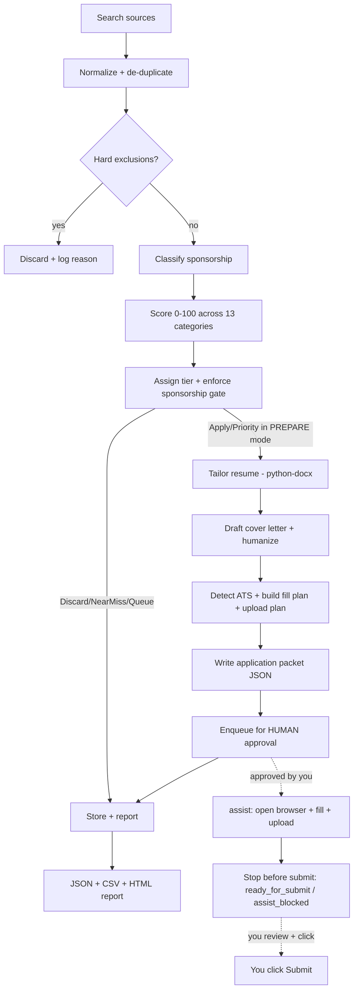

# job-agent

A **local-first** automated job search, resume tailoring, and **human-approved**
application assistant, tuned for a senior data engineer profile that requires
visa sponsorship.

> It searches jobs, scores them against your profile, tailors your resume, drafts
> cover letters, detects the ATS, assembles a ready-to-review **application
> packet** for each strong match, and can **open the apply page in a real browser
> and fill the form for you**. It **never clicks submit on its own** unless every
> safety gate passes — a human reviews and authorizes every submission.

---

## TL;DR — what it actually does

1. **Finds jobs** from configured public ATS endpoints (Greenhouse, Lever,
   Ashby, Workday, and SmartRecruiters), provider feeds, public JSON-LD job
   pages, and CSV/URL lists you provide.
2. **De-duplicates** and stores every job in a local SQLite database.
3. **Filters out** disqualifiers (no-sponsorship, clearance-required, junior,
   wrong employment type, wrong geography, stale postings).
4. **Classifies sponsorship** likelihood (Confirmed / Likely / Unconfirmed).
5. **Scores** each job 0–100 across 13 weighted, config-driven categories.
6. **Assigns a tier** (Priority / Apply / Queue / Near miss / Discard) and
   enforces a hard rule: a job can't be "Apply/Priority" unless sponsorship is
   acceptable or you explicitly approved it.
7. **Tailors your resume** (Python/`python-docx`) by emphasizing skills you
   *already have* — never inventing anything — and saves a per-job copy.
8. **Drafts a cover letter** (180–260 words, banned phrases and em dashes
   stripped) only when warranted.
9. **Builds an application packet**: detected ATS platform + a form pre-fill plan
   + screening-question answers + a file-upload plan.
10. **Queues the packet for human approval.**
11. **Assists the apply (optional):** after you approve a packet, it opens the
    apply page in a real browser, fills known fields, uploads the tailored
    resume/cover letter, advances safe Next/Continue steps, and **stops before
    submit** — handing control back to you. It never clicks the final Submit.

---

## Does it use Playwright to apply to jobs? (Important)

**Yes — for assisted form-filling, behind a strict safety gate.** The agent can
open a job's apply page in a real Chromium browser, fill the fields it knows, and
upload your tailored documents. What it **never** does is bypass protections or
submit without authorization.

First it does the *thinking* part deterministically and hands you a finished
packet:

- It **detects the ATS** (Greenhouse, Lever, Workday, iCIMS, Taleo,
  SmartRecruiters, Jobvite, or generic) from the URL/markup.
- It builds a **fill plan** — an explicit list of `field label → value → CSS
  selector → source` entries — using your profile and your configured screening
  answers. Each platform adapter knows that ATS's common field selectors.
- It builds an **upload plan** that verifies the tailored resume (and optional
  cover letter) exist and are valid file types.
- Every plan is marked `submitReady: false` and `stopBeforeSubmit: true`.

Then, when you run `assist` on an **approved** packet, it:

1. Opens the apply page and runs **page guards** — if it sees a CAPTCHA, login
   wall, MFA prompt, or bot-protection page, it **stops** and leaves the browser
   open for you. It never tries to solve or evade these.
2. Fills only the fields it can resolve confidently; unknown screening questions
   become **blockers** for you to answer.
3. Uploads the tailored resume (and cover letter) to the file inputs.
4. Clicks only **safe navigation** controls (Next / Continue / Review) to advance
   multi-step forms — and **stops before the final Submit**.

**Does it ever click submit?** Not by default. After it fills and uploads
everything it can, it leaves the job as `ready_for_submit` (or `assist_blocked`
when it needs your input) with the browser open on the final page, so you
review and click **Submit** yourself.

There is ONE exception, and it is entirely in your hands: when you explicitly
opt in to **auto-submit for that specific run** (the dashboard asks you each
time), the runner clicks the final Submit — but only on a completely clean form
(zero blockers, every required field filled, truthful sponsorship answers, a
confidently-identified submit button) and within your daily application cap.
Even then, a job is only recorded as **submitted** when the runner VERIFIES the
submission (a confirmation page, or a redirect with the form gone). An
unverified click is surfaced as `submit_unverified` for you to confirm — it is
never silently counted as an application.

---

## End-to-end pipeline (step by step)



What happens at each stage, concretely:

| Stage | Module | What it does |
| --- | --- | --- |
| Search | `src/search/` | Calls Greenhouse/Lever public APIs, parses JSON-LD from public job pages, and imports your CSV/URL lists. No login automation, no stealth. |
| Normalize | `src/search/normalize.js` | Converts every source into one canonical job shape with a stable ID. |
| De-dupe | `src/search/deduplicator.js` | Drops repeats (keeps the richer JD); skips jobs you've already **applied** to (toggle via `EXCLUDE_ALREADY_APPLIED`). |
| Freshness | `src/search/freshnessFilter.js` | Keeps dated postings per `JOB_FRESHNESS_MODE` (LAST_24_HOURS / LAST_3_DAYS / LAST_7_DAYS / ALL). The supplied broad-coverage configuration uses **ALL**, then applies the separate 45-day stale-posting guard. Auto-widens to a 3-day window when a strict window is thin (`INCLUDE_LAST_3_DAYS_FALLBACK`). Undated board jobs go to a visible date-unconfirmed review bucket when `INCLUDE_UNKNOWN_DATE_JOBS=true`, rather than being silently dropped. |
| Exclude | `src/scoring/exclusionFilter.js` | Discards no-sponsorship, clearance, junior/unrelated, wrong-geo, and stale postings. The US-only gate reads its US signal from `src/utils/usGeography.js` (all 50 states, DC, and the territories, by name and USPS code), so a US city that shares a name with a foreign one is kept; only a genuinely foreign location is dropped, and an unknown or ambiguous one is always kept for you to judge. C2C, 1099, part-time, freelance, and other employment arrangements remain visible and are classified for UI filtering. |
| Sponsorship | `src/scoring/sponsorshipClassifier.js` | Confirmed / Likely / Unconfirmed from JD phrases + known-sponsor list in config. |
| Score | `src/scoring/scorer.js` | 13 weighted categories (title, seniority, Azure/Fabric stack, data-eng stack, BI/semantic, Python/SQL/PySpark, domain, sponsorship, geography, freshness, direct-ATS, company likelihood, resume alignment) → normalized 0–100. Fully deterministic. |
| Tier + gate | `src/scoring/explainScore.js` | Priority ≥85, Apply ≥75, Queue ≥60, Near miss ≥50. Downgrades Apply/Priority → Queue unless sponsorship is acceptable or you approved it. The dashboard still shows these gated 75+ roles as **strong fits** with a "⚠ verify sponsorship first" action — fit measures the ROLE match; sponsorship feasibility is reported separately, and the gate only blocks auto-preparation. Only Priority/Apply tiers are auto-prepared; Queue-tier jobs are prepared **only** when you select them yourself ("Prepare selected"). |
| Tailor resume | `src/resume/tailor.py` | Opens the master read-only and bolds skills you already have that match the JD. Saves into the job's `applications/output/` folder. Never fabricates skills. Repairs layout artifacts (manual page breaks, merged role blocks, blank filler) and holds the result to **2 pages** by omitting whole low-relevance bullets from the oldest roles — never shortening or rewording a claim, never dropping a role, its dates, or its last bullet. Omissions are listed for review. (An optional per-job "Most relevant to this role" focus line is available but **off by default** — enable with `config.runtime.resumeFocusLine === true`.) |
| Cover letter | `src/apply/coverLetter.js` | Deterministic template filled from your profile, then humanized (banned phrases + em dashes removed), 180–260 words, only when score ≥ threshold or required. |
| Packet | `src/apply/applicationPacket.js` | Bundles job + score + tier + resume path + cover letter + ATS + fill plan + upload plan. Always `submitReady: false`. |
| Approval | `src/apply/approvalQueue.js` | Writes the packet to the approval queue as `pending_review`. The compliance choke point. |
| Assist apply | `src/automation/applyRunner.js` | After your approval, opens the apply page, runs guards, fills fields, uploads docs, advances safe Next/Continue steps, and stops before submit. |
| Page guards | `src/automation/guards.js` | Detects CAPTCHA / login / MFA / bot walls and forces a stop — never evades them. |
| Report | `src/reports/reportGenerator.js` | Writes JSON + CSV + HTML summaries to `reports/`. |

---

## Chrome / Edge assisted-fill extension

The unpacked Manifest V3 extension in `extension/` moves an approved job from its posting to the real application and fills the current form step in your normal signed-in Chrome or Edge profile. It uses only a human-approved application packet, recognizes verified LinkedIn/Indeed redirects, clicks only an initial Apply/Apply Now control, highlights fields it filled, uploads only the packet's approved resume/cover-letter artifacts, records a privacy-minimized truthful result in the dashboard, and always leaves final submission to you.

1. Start the dashboard with `npm run dashboard`.
2. Open `chrome://extensions` or `edge://extensions`, enable **Developer mode**, choose **Load unpacked**, and select this repository's `extension` folder.
3. Open the extension's **Connection settings**. Keep the server at `http://127.0.0.1:4646` and paste the value of `JOB_AGENT_EXTENSION_KEY` from your local `.env` file.
4. Prepare and approve a job in the Job Agent UI, select its row, and click the extension. The selected ID is transferred automatically through the dashboard URL—no copying or pasting.
5. Choose **Open application**. On LinkedIn/Indeed or an employer job page, choose **Start / fill application**: the extension safely starts the application when needed, or fills the visible form step and attaches the approved resume. Review the step, continue, and run it again on later ATS steps. You always click the final Submit button yourself.

Security boundaries: the server remains loopback-only; extension requests require the high-entropy shared key and reject cross-site browser traffic; only approved packets are readable; artifact paths must remain inside the repository; already-submitted jobs are blocked; the extension receives no permanent website access (`activeTab` only); job context is verified before navigation/filling; and it never fills passwords, CAPTCHAs, voluntary demographic fields, legal attestations, or submit controls. Rotate the key if it is ever exposed and restart the dashboard after changing it.

## Safety & compliance principles

1. No bypassing CAPTCHAs, bot protections, paywalls, MFA, rate limits, or platform security.
2. Prefer official APIs, RSS feeds, public job pages, user-provided URLs, and ATS pages.
3. No stealth browser evasion, webdriver hiding, fake user agents, or aggressive scraping.
4. Never fabricate candidate data, resume content, skills, certifications, history, salary, education, or immigration status.
5. Auto-search, auto-score, auto-tailor, and form pre-fill *planning* are allowed; **the final submit is human-gated** — either you click it, or you explicitly opted in to auto-submit for that run.
6. The only automated submit path is `applyRunner.tryAutoSubmit`, strictly gated behind the per-run `options.autoSubmit === true` opt-in, a clean form, and the daily cap — and "submitted" is only recorded after the submission is verified (`npm run verify` asserts these gates exist).
7. Every application packet is fully reviewable before anything happens.
8. Sponsorship/work-authorization answers are always truthful and config-driven; the agent never claims "no sponsorship required." **Negatively-phrased sponsorship questions** ("can you work here *without* sponsorship?") are never auto-answered at all — pattern matching is polarity-blind, so inverting the stored answer would be a guess about immigration status. They always go to you.
9. Ambiguous, legal, immigration, salary, or relocation questions pause and ask you.

---

## Optional LLM assist — what it may and may not do

Off by default. Enable with `LLM_ASSIST=on` plus an API key (see `.env.example`).
It is deliberately confined to **one narrow, verifiable job**.

**The problem it solves.** The deterministic tailor can only recognize
requirements that already appear in `config/scoring.json`'s keyword vocabulary. A
posting asking for "dimensional modeling", "Iceberg", or "dbt exposures" surfaces
nothing if those terms were never listed — so the resume is never reordered to
answer them, and they are never reported as gaps. Hand-maintaining that
vocabulary across every employer's phrasing does not scale.

**What it does.** The model READS the job description and proposes requirement
phrases. That is all.

**Why it cannot fabricate.** Every proposed phrase is verified to occur
**verbatim in that job description** before it is accepted. A phrase the model
invented cannot survive the check, so hallucination is structurally impossible
rather than merely discouraged. Rejected phrases are counted and shown in the
packet.

**What it never touches.** It does not write, reword, or suggest resume prose.
Accepted phrases are handed to the same deterministic tailor, which only
reorders and emphasizes text **already present in your master resume** and
reports everything else as an honest gap. Free-form resume rewriting stays
disabled — see the module docstring in `src/resume/tailor.py` for why.

**Privacy boundary.** Only the public job description and title are sent. Your
resume, contact details, EEO answers, and salary expectations are never
transmitted.

**Other guarantees.** Never consulted on the auto-submit path. Deterministic
(`temperature: 0`) and cached by content hash, so re-preparing a job is free and
its audit trail is reproducible. Disabled, offline, slow, or malformed responses
all fall back silently to the deterministic path.

| Layer | Who decides | Can it invent? |
|---|---|---|
| JD requirement extraction | LLM proposes, grounding check verifies | No — unverifiable phrases are dropped |
| Resume content selection | Deterministic tailor | No — only reorders existing text |
| Gap reporting | Deterministic tailor | No — reports what is missing, adds nothing |
| Screening answers | Your `config/screening_answers.json` | No — LLM is not involved |
| Final submit | You | n/a |

---

## Application phases / modes

Each phase is a CLI command (see **Commands** below). They form a pipeline you can
run all at once or one step at a time:

| Phase / command | Behavior |
| --- | --- |
| `discover` | Search only. Writes `data/found_jobs.json` (every job + what happened to it). No scoring, no secrets. |
| `score` | Search + score. Writes `scored_jobs.json` + `queued_jobs.json`. No packets. |
| `prepare-apps` | Everything above, plus: tailor resumes, draft cover letters, build packets, and queue them for human review. **No browser, no submit.** |
| `assist` | Opens approved packets in a real browser, fills + uploads, advances safe Next/Continue steps, then **stops before submit** (`ready_for_submit`). You click Submit. |
| `end-to-end` | `prepare-apps` → `assist`, stopping at the human-approval boundary. |

Valid run modes are **`DRY_RUN`**, **`PREPARE`**, and **`LIVE_ASSIST`** (set via
`RUN_MODE` or `--mode`). Any unknown or legacy value falls back to `DRY_RUN`.
Unattended auto-submit is intentionally **not** possible — submission happens
only when you click Submit yourself, or when you explicitly opt in to
auto-submit for a specific run (and even then only verified submissions are
recorded as submitted).

---

## Tech stack

- **Node.js 22.5+** (the `node:sqlite` built-in requires it) — orchestration, search connectors, scoring, ATS form-prep planning
- **Python 3.12 + python-docx** — resume editing/audit/tailoring
- **SQLite via the built-in `node:sqlite`** module (no native build step; not `better-sqlite3`)
- **Playwright** — drives a real Chromium for **assisted** form-filling on
  approved packets; runs page guards and stops before submit. Never used to
  scrape or evade protections.
- **dotenv** (secrets), **pino** (structured JSON logs), **ajv** (config validation)
- **vitest** (Node tests), **pytest** (Python tests)

---

## Setup

```bash
# Node dependencies
npm install

# Python dependencies (docx2pdf is optional; it needs MS Word)
pip install -r requirements.txt

# Secrets (only needed for AI-assisted features later; DRY_RUN needs none)
cp .env.example .env   # then edit .env
```

Place your master resume at `resumes/base/MASTER_RESUME.docx`. It is opened
**read-only** and is **never overwritten** — tailored copies go to
`resumes/output/`.

Or do it from the dashboard: **More ▾ → 🧾 Master resume…** shows the document's
real text (so you can confirm what tailoring reads, not just the filename),
downloads it for editing, and uploads a replacement. An upload is validated
before it lands — a renamed PDF or a file with no readable text is refused — and
the version it replaces is kept in `resumes/base/history/` for one-click
rollback.

### Preflight (recommended before the first run)

```bash
npm run doctor    # alias: npm run preflight
```

This checks everything the pipeline depends on and prints one readable
checklist: Node version, SQLite, config schemas, required candidate profile
fields, the master resume, Python + python-docx, Playwright Chromium, output
directory permissions, and test fixtures. Failures block the run; degraded
capabilities (e.g. no Python → untailored master-resume fallback) are warnings.
Add `--json` for machine-readable output. Exit code is 0 only when nothing failed.

It also reports **truthful profile gaps** (e.g. an empty street address or
GitHub URL). These are never invented — fill them in `config/candidate.json`
yourself, and only with real information.

### The dashboard (recommended cockpit)

**Easiest start (Windows): double-click `start-dashboard.cmd`** in the
`job-agent` folder. It installs dependencies on first run, starts the server
from the right place (no matter where you launch it from), and opens your
browser automatically once it's ready. Pass a port to override the default,
e.g. `start-dashboard.cmd 5000`. Stop it with Ctrl+C.

Or from a terminal in this folder:

```bash
npm run dashboard     # then open http://127.0.0.1:4646
```

A local-only web dashboard (binds to 127.0.0.1, zero extra dependencies) that
drives the whole workflow from the browser:

- **Tiles**: jobs tracked, discovered today, posted in the last 24 h, strong /
  medium / weak fit, shortlisted, pending review, prepared today, ready to
  submit, submitted today, blocked, rejected — each tile filters the board.
- **Board**: search, filter, sort (grade / company / newest), and compare up to
  three jobs side by side. Filters sit in two visible lanes — search, fit,
  status, posting age and remote on the first; sponsorship, job type, source,
  ATS, resume state and closed jobs on a quieter second lane. Nothing is behind
  a dropdown, so a filter can never narrow the board out of sight. Every applied
  filter also appears as a chip you can clear individually.
- **Nationwide coverage, stated as data**: every configured search asks for the
  whole United States, and the header shows how many of the 56 US states and
  territories the open board actually spans (with a per-state breakdown under
  "Where the jobs are"). The US-only gate recognizes all of them by name and by
  USPS code, so US cities that share a name with a foreign one — Dublin OH,
  Vienna VA, Ontario CA, Athens GA, Cambridge MA — are never discarded.
- **Master resume**: view the document's real text, download it to edit, and
  upload a replacement — validated before it lands, with the previous version
  kept for one-click rollback (**More ▾ → 🧾 Master resume…**).
- **Why it fits**: every job shows its score explanation, the JD skills you
  have, and the JD skills not evidenced in your profile. A skill-alias
  ontology (`config/scoring.json` → `evidenceAliases`) keeps these two lists
  consistent — "ADF" in a JD is evidenced by "Azure Data Factory" in your
  profile, "lakehouse" by "Delta Lake"/"Databricks", and so on.
- **Verify sponsorship queue**: strong-fit roles (score ≥75) whose sponsorship
  is unverified are surfaced with a "verify" chip and their own tile/next
  action instead of being hidden in the medium bucket — the safety gate still
  keeps them out of auto-preparation until you confirm the employer sponsors.
- **Actions**: shortlist · reject · archive · approve packet · *Fill in browser
  (stops before submit)* · *I submitted it myself* (the only path to
  "submitted" — the system never sets it on its own).
- **Pipeline buttons**: Discover / Score / Find & Prepare run the real pipeline
  in the background. A run shows live in the header as a progress pill —
  what it is doing, how many of how many boards are done, which board is
  current, and elapsed time — with a determinate progress line on the header's
  bottom edge. **Details** opens the per-board breakdown (found counts, errors,
  duration, cache hits) and, when something failed, its *cause*: the failure
  category, HTTP status, the provider's own message, and what to do about it.
  Results stay until you dismiss them.
- **Source breakdown**: found / strong / prepared / submitted per source
  (Greenhouse, Lever, Ashby, SmartRecruiters, Workday, manual lists, …).
- **Sponsorship breakdown**: Confirmed / Likely / Unconfirmed counts with how
  many of each are strong fits.
- **Daily progress**: discovered / prepared / submitted per day for the last
  7 days.
- **Next actions**: a ranked to-do list (filled apps waiting for your Submit,
  packets awaiting approval, blocked apps, strong fits with no decision,
  unconfirmed posting dates) — each links to the filtered board view.
- **Audit trail**: every recorded event for a job (scored, prepared, assisted,
  blocked) in the detail panel, plus the last assisted-fill result (fields
  filled + blockers).

Use `--port=NNNN` or `DASHBOARD_PORT` to change the port. The dashboard
enforces the same safety gates as the CLI: assisted filling only works on a
packet you approved, and it always stops before the final Submit.

### Run it (one command)

Once your resume and job source are in place, the whole thing is just:

```bash
npm start
```

This finds jobs, scores them, tailors resumes/cover letters, asks you which to
approve, and (optionally) opens a browser to fill them — stopping before submit.
See [Commands](#commands) for variants like `npm start -- --yes`.

### Feeding it jobs

The simplest input is a CSV at `data/jobs_input/manual_jobs.csv`:

```csv
source,company,title,location,url,jd_text,posted_at,applicant_count,employment_type
manual,Globex,Lead Data Engineer,"Remote, US",https://boards.greenhouse.io/globex/jobs/42,"Azure Databricks, PySpark, Delta Lake. Visa sponsorship available.",2026-06-02,17,Full-time
```

To pull from live ATS boards, enable the relevant source in
`config/jobboards.json` (e.g. add Greenhouse board tokens or Lever company slugs).

### Real multi-portal discovery via Apify

To discover jobs from LinkedIn, Indeed, Glassdoor, Google Jobs, etc. without
writing scrapers, use the **Apify** source. It calls the official Apify API with
**your** account token and runs maintained "actors" (scrapers) from the
[Apify Store](https://apify.com/store), mapping their output into the same
normalized job shape every other source uses.

1. Create a token at <https://console.apify.com/account/integrations> and put it
   in `.env` as `APIFY_TOKEN=...`.
2. In `config/jobboards.json`, set the `apify-scrapers` source to
   `"enabled": true` and list one or more actors:

```jsonc
{
  "id": "apify-scrapers",
  "adapter": "apify",
  "enabled": true,
  "priority": 2,
  "options": {
    "tokenEnv": "APIFY_TOKEN",
    "maxItemsPerActor": 100,
    "actors": [
      {
        "actorId": "bebity~linkedin-jobs-scraper",   // username~actor-name from the Store
        "label": "linkedin",
        "source": "linkedin",
        "input": { "title": "Senior Data Engineer", "location": "United States", "rows": 50 }
        // "fieldMap": { "title": "positionName", "url": "jobUrl" }  // optional overrides
      },
      { "datasetId": "your-existing-dataset-id" }       // OR: read a previous run's results
    ]
  }
}
```

The adapter auto-detects the common output fields of most job actors
(`title`/`positionName`, `companyName`, `location`, `url`/`jobUrl`,
`descriptionText`, `postedAt`, …). When an actor uses different field names, add
a per-actor `fieldMap`. The token is sent as an `Authorization: Bearer` header
(never in a URL) and actor failures are isolated — one bad actor never crashes
the run. Jobs found this way carry real apply URLs, so `assist` can navigate to
and fill the actual application pages.

**Cost and the monthly allowance.** Running an actor spends real money on your
Apify account; reading a saved `datasetId` does not. Retries reflect that — only
a 429 (rejected at the gate, nothing charged) is retried, because re-running a
timed-out `run-sync` call would pay for the same scrape twice.

Once the plan's monthly usage limit is reached, Apify **rejects every new actor
run**. The adapter therefore makes one free usage check before starting anything
and, if the allowance is spent, skips the actors entirely and reports a single
line naming the numbers and the reset date — instead of firing all 25 configured
actors at a wall and reporting 25 identical rejections with no cause. Other job
boards are unaffected, so a run still completes with everything they found. The
free plan's allowance is $5/month, which a full nationwide sweep can use up in a
day or two.

---

## Commands

### Maintenance / one-off scripts

```bash
npm run verify                          # repo + safety gate health check
node scripts/relabelUndatedJobs.mjs     # report rows mislabelled "stale: unknown posting date"
node scripts/relabelUndatedJobs.mjs --apply   # relabel them as "unknown posting date"
pip install -r requirements-llm.txt     # ONLY if you enable LLM_ASSIST
python test_api_key.py                  # check the LLM key/endpoint (reads env only)
```


### One command (recommended)

```bash
npm start              # the whole flow, guided, in one go
```

`npm start` runs everything as a single interactive session:

1. **Find → score → prepare** in one pass (no separate `discover`/`score`/`prepare-apps`).
2. **Review & approve** — it lists the prepared packets and asks which to approve,
   right there. No copying ids around: just type `a` (all), `n` (none), or numbers
   like `1,3` or `1-2`.
3. **Assist** — it offers to open a browser and fill the approved applications,
   then **stops before submit** so you review and submit yourself.

It also refreshes the Excel tracker (`data/job_tracker.csv`) along the way.

Handy variants:

```bash
npm start                 # interactive: asks what to approve, then offers to fill
npm start -- --yes        # auto-approve every prepared packet, then fill (still stops before submit)
npm start -- --prepare-only   # just find + score + prepare, stop at the approval gate
npm start -- --no-assist  # approve, but don't open the browser
```

> Nothing is ever submitted automatically. `--yes` only auto-*approves* and
> fills the forms; you always review and submit each one yourself.

### Pipeline (run in order, or jump to a phase)

Prefer `npm start` above. These individual commands are for power users who want
to run a single phase:

```bash
npm run discover       # search only            -> data/found_jobs.json
npm run score          # + score                -> scored_jobs.json + queued_jobs.json
npm run prepare-apps   # + tailor + packets     -> applications/output/ + approval queue
npm run assist         # open browser + fill, STOP before submit (you click Submit)
npm run end-to-end     # prepare-apps -> assist (stops at approval boundary)
```

### Human approval workflow

```bash
npm run approvals          # list packets awaiting your review
npm run packets            # list prepared packets (company, score, tier, blockers)
npm run packet -- <id>     # show one packet in full (by job id or packet id)
npm run approve -- <id>    # record YOUR approval for a packet
npm run reject -- <id>     # reject a packet
```

> The `--` is required so npm passes the id through to the command, e.g.
> `npm run approve -- 8aedd008-aebe-40d0-b48f-4a61490a8730`.

### Utilities & tests

```bash
npm run doctor         # preflight checks (env, config, resume, browsers, dirs)
npm run report         # regenerate reports from stored data
npm run verify         # repo health + safety check (submit stays human-gated)
npm run db:maintenance # checkpoint the SQLite WAL (+ --vacuum to compact)
npm test               # Node test suite (vitest)
npm run test:py        # Python test suite (pytest; requires `python` on PATH)
```

### Typical flow

```bash
npm start                            # the guided one-command flow (recommended)
```

Or, doing it phase by phase (power users):

```bash
npm run prepare-apps                 # build + queue packets for strong matches
npm run packets                      # see what's queued
npm run packet -- <id>               # review one in detail
npm run approve -- <id>              # approve the ones you want
npm run assist                       # browser fills the approved forms, stops before submit
# ...you review the filled form in the open browser and click Submit yourself.
```

A typical `prepare-apps` run prints, per strong match, a `cover_letter_generated`
and an `approval_required` log line, and writes the packet to `applications/output/`.

---

## Where things land on disk

```
config/    validated config files + JSON schemas (the source of truth)
           candidate.json + screening_answers.json hold YOUR personal data and are
           gitignored — copy the *.example.json templates and fill them in
src/       Node + Python modules (cli, config, search, scoring, resume, apply, automation, reports, logging, utils)
scripts/   maintenance scripts (migrate-output-names, cleanup-outputs, verify,
           db-maintenance, regenerate-resumes, plus ad-hoc dev/debug .mjs tools)
resumes/   base/ (master, read-only) and output/ (tailored drafts + cover letters)
applications/
  output/       one JSON application packet per prepared job (review these)
data/
  jobs_input/   your manual_jobs.csv
  found_jobs.json   every discovered job + its lifecycle status
  scored_jobs.json  every scored job (tier + sponsorship breakdown)
  queued_jobs.json  only actionable jobs (Priority/Apply/Queue)
  unknown_date_review.json  undated jobs held for your manual review (opt-in)
  applied_jobs.db   local SQLite store (jobs, runs, events, approval queue)
reports/   report-YYYYMMDD.json / .csv / .html summaries
logs/      structured JSON run logs
tests/     node/ (vitest) and python/ (pytest)
```

Each packet in `applications/output/` is the thing you review: it contains the job, the
score and tier, the tailored resume path, the cover letter path, the detected
ATS, the per-field fill plan, the upload plan, and any blockers/questions that
need your input.

---

## Build status

This project is built in strict phases. **Current state: all phases complete,
including the browser-assisted apply layer, a production-hardening pass, and a
data-quality audit pass (563 JS + 40 Python tests passing).**

- [x] Phase 1 — Scaffold (dirs, config, schemas, project metadata)
- [x] Phase 2 — Config + utilities (loaders, validation, rate limit, retry, credentials, notifier, text, dates) + tests
- [x] Phase 3 — Database (node:sqlite) + logging (pino) + report generator + tests
- [x] Phase 4 — Search + normalization (official ATS APIs + public-page JSON-LD + dedupe) + tests
- [x] Phase 5 — Filtering + scoring (exclusions, sponsorship classifier, scorer, explain/tier gate) + tests
- [x] Phase 6 — Resume tailoring (Python: audit, humanizer, tailor, pdf) + cover letter (JS) + tests
- [x] Phase 7 — Application packet + human approval queue + ATS detection + screening Q&A + form-prep platforms + tests
- [x] Phase 8 — Main runner + CLI (DRY_RUN / PREPARE / LIVE_ASSIST modes) + tests
- [x] Phase 9 — End-to-end dry run + prepare run verified
- [x] Phase 10 — Lifecycle statuses + clean output artifacts (found/scored/queued_jobs.json) + runtime resume tailoring wired into the pipeline
- [x] Phase 11 — Browser automation (guards, field resolver, upload runner, assist apply runner — fills + advances safe steps, never submits) + phase commands + approval CLI + tests/fixtures

---

## Configuration is the source of truth

The **config files** — not source code — are authoritative:

- `config/candidate.json` — your profile, skills, work authorization
  (**gitignored — personal data**; copy `config/candidate.example.json` to create it)
- `config/scoring.json` — weights, tiers, keywords, sponsorship signals
- `config/exclusions.json` — hard disqualifier phrases
- `config/screening_answers.json` — truthful, pattern-matched answers to form questions
  (**gitignored — personal data**; copy `config/screening_answers.example.json` to create it)
- `config/cover_letter.json` — cover-letter template + thresholds
- `config/humanizer_patterns.json` — banned phrases/characters to strip
- `config/jobboards.json` — which sources are enabled

Secrets live only in `.env`. Scoring weights, exclusions, screening answers, and
profile values are never hardcoded in source.
# Job Search Workbench support matrix

The dashboard is a dense, one-page daily workbench: workflow tabs and the job table stay in the main column, while priorities and the selected-job inspector remain in the right column. Documents, analytics, settings, and run RCA open as utility drawers instead of replacing the workbench.

| Source / ATS | Discovery and detail | Auto-Fill | Verified Auto-Apply | Important limits |
| --- | --- | --- | --- | --- |
| Greenhouse | Official public board API | Fixture-tested common fields and resume upload | Eligible only after packet, resume, screening, duplicate, and consent checks | Live ATS-specific submission is not manually verified in this repository |
| Lever | Official public postings API | Fixture-tested | Same fail-closed gate | Live ATS-specific submission is not manually verified |
| Ashby | Official public postings API, including available compensation | Fixture-tested | Same fail-closed gate | Live ATS-specific submission is not manually verified |
| Workday | Configured public CXS endpoints | Fixture-tested multi-step form behavior | Same fail-closed gate | Tenant schemas vary; authentication, CAPTCHA, and MFA are not bypassed |
| SmartRecruiters | Official public postings endpoints | Fixture-tested | Same fail-closed gate | Tenant-specific fields can require review |
| Generic company pages | JSON-LD/manual URL ingestion where available | Fixture-tested conservative field matching | Same fail-closed gate for the generic fixture family | Unknown or required fields stop for review |
| LinkedIn / Indeed / Dice | Configured provider results and manual/direct job URLs | Only after reaching a supported external application form | Not eligible on protected marketplace pages | No login-wall, CAPTCHA, rate-limit, or anti-bot bypass |
| iCIMS / Taleo / Jobvite | Manual/direct URL workflows may prefill recognizable fields | Best effort | Not in the verified Auto-Apply allowlist | Review and submit manually |

“Fixture-tested” means the repository test fixtures demonstrated the behavior. It does not mean every live tenant or page variant was manually demonstrated. The product never treats a clicked Submit button as proof of application: `applied=1` requires positive confirmation evidence (for example, a confirmation page or confirmation number). A browser close, ambiguous response, or validation failure remains resumable and unverified.

## Auto-Apply safety model

Auto-Apply is off by default and requires explicit, one-run authorization in the eligibility preview. The server re-runs the same checks immediately before opening a browser. A job is excluded when it is already applied, duplicated, rejected, archived, missing a prepared packet or resume, has unresolved screening questions or upload blockers, requires unsafe sponsorship answers, has an unsupported ATS, or lacks a valid application URL.

Durable checkpoints distinguish `precheck`, `filling`, `review`, `ready`, `submitting`, `verifying`, `user_submitted`, `verified`, `blocked`, `failed`, and `cancelled`. Submission-attempt phases cannot silently reopen and submit again. Failed or cancelled pre-submission work can be resumed from saved completed fields.

## Launch and verification

Run `npm run app` for the canonical launcher. It starts the local dashboard, selects a fallback port when the preferred port is occupied, prints the URL, opens a browser when the environment permits it, and shuts down on Ctrl+C. On Windows, `start-dashboard.cmd` invokes the same launcher.

Useful checks:

```text
npm run verify
npm run doctor
npx vitest run
npm run test:py
```

Run-level failures and partial source failures appear in the Activity/RCA drawer with sanitized symptoms, likely cause, retry guidance, retryability, and whether partial results remain valid. Secrets and screening answers are not included in these entries.
