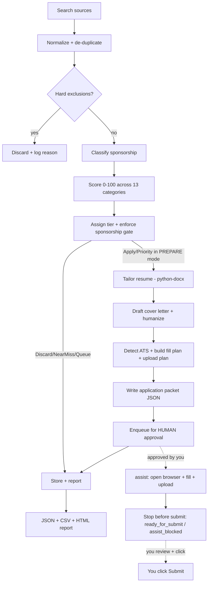

# job-agent

A **local-first** automated job search, resume tailoring, and **human-approved**
application assistant, tuned for a senior data engineer profile that requires
visa sponsorship.

> It searches jobs, scores them against your profile, tailors your resume, drafts
> cover letters, detects the ATS, assembles a ready-to-review **application
> packet** for each strong match, and can **open the apply page in a real browser
> and fill the form for you**. It **never clicks submit on its own** unless every
> safety gate passes — a human reviews and authorizes every submission.

---

## TL;DR — what it actually does

1. **Finds jobs** from official ATS APIs (Greenhouse, Lever), public job pages
   (JSON-LD), and CSV/URL lists you provide.
2. **De-duplicates** and stores every job in a local SQLite database.
3. **Filters out** disqualifiers (no-sponsorship, clearance-required, junior,
   wrong employment type, wrong geography, stale postings).
4. **Classifies sponsorship** likelihood (Confirmed / Likely / Unconfirmed).
5. **Scores** each job 0–100 across 13 weighted, config-driven categories.
6. **Assigns a tier** (Priority / Apply / Queue / Near miss / Discard) and
   enforces a hard rule: a job can't be "Apply/Priority" unless sponsorship is
   acceptable or you explicitly approved it.
7. **Tailors your resume** (Python/`python-docx`) by emphasizing skills you
   *already have* — never inventing anything — and saves a per-job copy.
8. **Drafts a cover letter** (180–260 words, banned phrases and em dashes
   stripped) only when warranted.
9. **Builds an application packet**: detected ATS platform + a form pre-fill plan
   + screening-question answers + a file-upload plan.
10. **Queues the packet for human approval.**
11. **Assists the apply (optional):** after you approve a packet, it opens the
    apply page in a real browser, fills known fields, uploads the tailored
    resume/cover letter, advances safe Next/Continue steps, and **stops before
    submit** — handing control back to you. It never clicks the final Submit.

---

## Does it use Playwright to apply to jobs? (Important)

**Yes — for assisted form-filling, behind a strict safety gate.** The agent can
open a job's apply page in a real Chromium browser, fill the fields it knows, and
upload your tailored documents. What it **never** does is bypass protections or
submit without authorization.

First it does the *thinking* part deterministically and hands you a finished
packet:

- It **detects the ATS** (Greenhouse, Lever, Workday, iCIMS, Taleo,
  SmartRecruiters, Jobvite, or generic) from the URL/markup.
- It builds a **fill plan** — an explicit list of `field label → value → CSS
  selector → source` entries — using your profile and your configured screening
  answers. Each platform adapter knows that ATS's common field selectors.
- It builds an **upload plan** that verifies the tailored resume (and optional
  cover letter) exist and are valid file types.
- Every plan is marked `submitReady: false` and `stopBeforeSubmit: true`.

Then, when you run `assist` on an **approved** packet, it:

1. Opens the apply page and runs **page guards** — if it sees a CAPTCHA, login
   wall, MFA prompt, or bot-protection page, it **stops** and leaves the browser
   open for you. It never tries to solve or evade these.
2. Fills only the fields it can resolve confidently; unknown screening questions
   become **blockers** for you to answer.
3. Uploads the tailored resume (and cover letter) to the file inputs.
4. Clicks only **safe navigation** controls (Next / Continue / Review) to advance
   multi-step forms — and **stops before the final Submit**.

**Does it ever click submit?** No. This assistant never submits an application
for you. After it fills and uploads everything it can, it leaves the job as
`ready_for_submit` (or `assist_blocked` when it needs your input) with the
browser open on the final page, so you review and click **Submit** yourself.
This is a deliberate safety design, not a limitation to work around.

---

## End-to-end pipeline (step by step)



What happens at each stage, concretely:

| Stage | Module | What it does |
| --- | --- | --- |
| Search | `src/search/` | Calls Greenhouse/Lever public APIs, parses JSON-LD from public job pages, and imports your CSV/URL lists. No login automation, no stealth. |
| Normalize | `src/search/normalize.js` | Converts every source into one canonical job shape with a stable ID. |
| De-dupe | `src/search/deduplicator.js` | Drops repeats (keeps the richer JD); skips jobs you've already **applied** to (toggle via `EXCLUDE_ALREADY_APPLIED`). |
| Freshness | `src/search/freshnessFilter.js` | Keeps recent **dated** postings only, per `JOB_FRESHNESS_MODE` (LAST_24_HOURS / LAST_3_DAYS / LAST_7_DAYS / ALL). Auto-widens to a 3-day window when a strict window is thin (`INCLUDE_LAST_3_DAYS_FALLBACK`). Undated board jobs are **never** mixed into fresh results; with `INCLUDE_UNKNOWN_DATE_JOBS=true` they go to a separate review bucket (`data/unknown_date_review.json`), otherwise they are dropped. |
| Exclude | `src/scoring/exclusionFilter.js` | Discards no-sponsorship, clearance, junior, C2C/part-time, wrong-geo, and stale postings — all phrases come from `config/exclusions.json`. |
| Sponsorship | `src/scoring/sponsorshipClassifier.js` | Confirmed / Likely / Unconfirmed from JD phrases + known-sponsor list in config. |
| Score | `src/scoring/scorer.js` | 13 weighted categories (title, seniority, Azure/Fabric stack, data-eng stack, BI/semantic, Python/SQL/PySpark, domain, sponsorship, geography, freshness, direct-ATS, company likelihood, resume alignment) → normalized 0–100. Fully deterministic. |
| Tier + gate | `src/scoring/explainScore.js` | Priority ≥85, Apply ≥75, Queue ≥60, Near miss ≥50. Downgrades Apply/Priority → Queue unless sponsorship is acceptable or you approved it. |
| Tailor resume | `src/resume/tailor.py` | Opens the master read-only and bolds skills you already have that match the JD. Saves into the job's `applications/output/` folder. Never fabricates skills. (An optional per-job "Most relevant to this role" focus line is available but **off by default** — enable with `config.runtime.resumeFocusLine === true`.) |
| Cover letter | `src/apply/coverLetter.js` | Deterministic template filled from your profile, then humanized (banned phrases + em dashes removed), 180–260 words, only when score ≥ threshold or required. |
| Packet | `src/apply/applicationPacket.js` | Bundles job + score + tier + resume path + cover letter + ATS + fill plan + upload plan. Always `submitReady: false`. |
| Approval | `src/apply/approvalQueue.js` | Writes the packet to the approval queue as `pending_review`. The compliance choke point. |
| Assist apply | `src/automation/applyRunner.js` | After your approval, opens the apply page, runs guards, fills fields, uploads docs, advances safe Next/Continue steps, and stops before submit. |
| Page guards | `src/automation/guards.js` | Detects CAPTCHA / login / MFA / bot walls and forces a stop — never evades them. |
| Report | `src/reports/reportGenerator.js` | Writes JSON + CSV + HTML summaries to `reports/`. |

---

## Safety & compliance principles

1. No bypassing CAPTCHAs, bot protections, paywalls, MFA, rate limits, or platform security.
2. Prefer official APIs, RSS feeds, public job pages, user-provided URLs, and ATS pages.
3. No stealth browser evasion, webdriver hiding, fake user agents, or aggressive scraping.
4. Never fabricate candidate data, resume content, skills, certifications, history, salary, education, or immigration status.
5. Auto-search, auto-score, auto-tailor, and form pre-fill *planning* are allowed; **the final submit is always done by you**.
6. There is no auto-submit mode and no submit-click path anywhere in the code — `assist` (LIVE_ASSIST) fills and uploads, then stops on the final page for you to submit.
7. Every application packet is fully reviewable before anything happens.
8. Sponsorship/work-authorization answers are always truthful and config-driven; the agent never claims "no sponsorship required."
9. Ambiguous, legal, immigration, salary, or relocation questions pause and ask you.

---

## Application phases / modes

Each phase is a CLI command (see **Commands** below). They form a pipeline you can
run all at once or one step at a time:

| Phase / command | Behavior |
| --- | --- |
| `discover` | Search only. Writes `data/found_jobs.json` (every job + what happened to it). No scoring, no secrets. |
| `score` | Search + score. Writes `scored_jobs.json` + `queued_jobs.json`. No packets. |
| `prepare-apps` | Everything above, plus: tailor resumes, draft cover letters, build packets, and queue them for human review. **No browser, no submit.** |
| `assist` | Opens approved packets in a real browser, fills + uploads, advances safe Next/Continue steps, then **stops before submit** (`ready_for_submit`). You click Submit. |
| `end-to-end` | `prepare-apps` → `assist`, stopping at the human-approval boundary. |

Valid run modes are **`DRY_RUN`**, **`PREPARE`**, and **`LIVE_ASSIST`** (set via
`RUN_MODE` or `--mode`). Any unknown or legacy value falls back to `DRY_RUN`.
Unattended auto-submit is intentionally **not** possible — this assistant never
clicks the final Submit; you always do.

---

## Tech stack

- **Node.js 22.5+** (the `node:sqlite` built-in requires it) — orchestration, search connectors, scoring, ATS form-prep planning
- **Python 3.12 + python-docx** — resume editing/audit/tailoring
- **SQLite via the built-in `node:sqlite`** module (no native build step; not `better-sqlite3`)
- **Playwright** — drives a real Chromium for **assisted** form-filling on
  approved packets; runs page guards and stops before submit. Never used to
  scrape or evade protections.
- **dotenv** (secrets), **pino** (structured JSON logs), **ajv** (config validation)
- **vitest** (Node tests), **pytest** (Python tests)

---

## Setup

```bash
# Node dependencies
npm install

# Python dependencies (docx2pdf is optional; it needs MS Word)
pip install -r requirements.txt

# Secrets (only needed for AI-assisted features later; DRY_RUN needs none)
cp .env.example .env   # then edit .env
```

Place your master resume at `resumes/base/MASTER_RESUME.docx`. It is opened
**read-only** and is **never overwritten** — tailored copies go to
`resumes/output/`.

### Preflight (recommended before the first run)

```bash
npm run doctor    # alias: npm run preflight
```

This checks everything the pipeline depends on and prints one readable
checklist: Node version, SQLite, config schemas, required candidate profile
fields, the master resume, Python + python-docx, Playwright Chromium, output
directory permissions, and test fixtures. Failures block the run; degraded
capabilities (e.g. no Python → untailored master-resume fallback) are warnings.
Add `--json` for machine-readable output. Exit code is 0 only when nothing failed.

It also reports **truthful profile gaps** (e.g. an empty street address or
GitHub URL). These are never invented — fill them in `config/candidate.json`
yourself, and only with real information.

### The dashboard (recommended cockpit)

```bash
npm run dashboard     # then open http://127.0.0.1:4646
```

A local-only web dashboard (binds to 127.0.0.1, zero extra dependencies) that
drives the whole workflow from the browser:

- **Tiles**: jobs tracked, discovered today, posted in the last 24 h, strong /
  medium / weak fit, shortlisted, pending review, prepared today, ready to
  submit, submitted today, blocked, rejected — each tile filters the board.
- **Board**: search, filter (fit / status / source / sponsorship / last-24 h),
  sort (score / newest / company / recently updated), and compare up to three
  jobs side by side.
- **Why it fits**: every job shows its score explanation, the matched skills
  found in the JD, and the missing/not-evidenced ones.
- **Actions**: shortlist · reject · archive · approve packet · *Fill in browser
  (stops before submit)* · *I submitted it myself* (the only path to
  "submitted" — the system never sets it on its own).
- **Pipeline buttons**: Discover / Score / Find & Prepare run the real pipeline
  in the background; status is shown live in the header.
- **Source breakdown**: found / strong / prepared / submitted per source
  (Greenhouse, Lever, Ashby, SmartRecruiters, Workday, manual lists, …).

Use `--port=NNNN` or `DASHBOARD_PORT` to change the port. The dashboard
enforces the same safety gates as the CLI: assisted filling only works on a
packet you approved, and it always stops before the final Submit.

### Run it (one command)

Once your resume and job source are in place, the whole thing is just:

```bash
npm start
```

This finds jobs, scores them, tailors resumes/cover letters, asks you which to
approve, and (optionally) opens a browser to fill them — stopping before submit.
See [Commands](#commands) for variants like `npm start -- --yes`.

### Feeding it jobs

The simplest input is a CSV at `data/jobs_input/manual_jobs.csv`:

```csv
source,company,title,location,url,jd_text,posted_at,applicant_count,employment_type
manual,Globex,Lead Data Engineer,"Remote, US",https://boards.greenhouse.io/globex/jobs/42,"Azure Databricks, PySpark, Delta Lake. Visa sponsorship available.",2026-06-02,17,Full-time
```

To pull from live ATS boards, enable the relevant source in
`config/jobboards.json` (e.g. add Greenhouse board tokens or Lever company slugs).

### Real multi-portal discovery via Apify

To discover jobs from LinkedIn, Indeed, Glassdoor, Google Jobs, etc. without
writing scrapers, use the **Apify** source. It calls the official Apify API with
**your** account token and runs maintained "actors" (scrapers) from the
[Apify Store](https://apify.com/store), mapping their output into the same
normalized job shape every other source uses.

1. Create a token at <https://console.apify.com/account/integrations> and put it
   in `.env` as `APIFY_TOKEN=...`.
2. In `config/jobboards.json`, set the `apify-scrapers` source to
   `"enabled": true` and list one or more actors:

```jsonc
{
  "id": "apify-scrapers",
  "adapter": "apify",
  "enabled": true,
  "priority": 2,
  "options": {
    "tokenEnv": "APIFY_TOKEN",
    "maxItemsPerActor": 100,
    "actors": [
      {
        "actorId": "bebity~linkedin-jobs-scraper",   // username~actor-name from the Store
        "label": "linkedin",
        "source": "linkedin",
        "input": { "title": "Senior Data Engineer", "location": "United States", "rows": 50 }
        // "fieldMap": { "title": "positionName", "url": "jobUrl" }  // optional overrides
      },
      { "datasetId": "your-existing-dataset-id" }       // OR: read a previous run's results
    ]
  }
}
```

The adapter auto-detects the common output fields of most job actors
(`title`/`positionName`, `companyName`, `location`, `url`/`jobUrl`,
`descriptionText`, `postedAt`, …). When an actor uses different field names, add
a per-actor `fieldMap`. The token is sent as an `Authorization: Bearer` header
(never in a URL) and actor failures are isolated — one bad actor never crashes
the run. Jobs found this way carry real apply URLs, so `assist` can navigate to
and fill the actual application pages.

---

## Commands

### One command (recommended)

```bash
npm start              # the whole flow, guided, in one go
```

`npm start` runs everything as a single interactive session:

1. **Find → score → prepare** in one pass (no separate `discover`/`score`/`prepare-apps`).
2. **Review & approve** — it lists the prepared packets and asks which to approve,
   right there. No copying ids around: just type `a` (all), `n` (none), or numbers
   like `1,3` or `1-2`.
3. **Assist** — it offers to open a browser and fill the approved applications,
   then **stops before submit** so you review and submit yourself.

It also refreshes the Excel tracker (`data/job_tracker.csv`) along the way.

Handy variants:

```bash
npm start                 # interactive: asks what to approve, then offers to fill
npm start -- --yes        # auto-approve every prepared packet, then fill (still stops before submit)
npm start -- --prepare-only   # just find + score + prepare, stop at the approval gate
npm start -- --no-assist  # approve, but don't open the browser
```

> Nothing is ever submitted automatically. `--yes` only auto-*approves* and
> fills the forms; you always review and submit each one yourself.

### Pipeline (run in order, or jump to a phase)

Prefer `npm start` above. These individual commands are for power users who want
to run a single phase:

```bash
npm run discover       # search only            -> data/found_jobs.json
npm run score          # + score                -> scored_jobs.json + queued_jobs.json
npm run prepare-apps   # + tailor + packets     -> applications/output/ + approval queue
npm run assist         # open browser + fill, STOP before submit (you click Submit)
npm run end-to-end     # prepare-apps -> assist (stops at approval boundary)
```

### Human approval workflow

```bash
npm run approvals          # list packets awaiting your review
npm run packets            # list prepared packets (company, score, tier, blockers)
npm run packet -- <id>     # show one packet in full (by job id or packet id)
npm run approve -- <id>    # record YOUR approval for a packet
npm run reject -- <id>     # reject a packet
```

> The `--` is required so npm passes the id through to the command, e.g.
> `npm run approve -- 8aedd008-aebe-40d0-b48f-4a61490a8730`.

### Utilities & tests

```bash
npm run doctor         # preflight checks (env, config, resume, browsers, dirs)
npm run report         # regenerate reports from stored data
npm run verify         # repo health + safety check (no auto-submit path)
npm test               # Node test suite (vitest)
npm run test:py        # Python test suite (pytest)
```

### Typical flow

```bash
npm start                            # the guided one-command flow (recommended)
```

Or, doing it phase by phase (power users):

```bash
npm run prepare-apps                 # build + queue packets for strong matches
npm run packets                      # see what's queued
npm run packet -- <id>               # review one in detail
npm run approve -- <id>              # approve the ones you want
npm run assist                       # browser fills the approved forms, stops before submit
# ...you review the filled form in the open browser and click Submit yourself.
```

A typical `prepare-apps` run prints, per strong match, a `cover_letter_generated`
and an `approval_required` log line, and writes the packet to `applications/output/`.

---

## Where things land on disk

```
config/    validated config files + JSON schemas (the source of truth)
src/       Node + Python modules (cli, config, search, scoring, resume, apply, automation, reports, logging, utils)
scripts/   maintenance scripts (migrate-output-names, cleanup-outputs, verify)
resumes/   base/ (master, read-only) and output/ (tailored drafts + cover letters)
applications/
  output/       one JSON application packet per prepared job (review these)
data/
  jobs_input/   your manual_jobs.csv
  found_jobs.json   every discovered job + its lifecycle status
  scored_jobs.json  every scored job (tier + sponsorship breakdown)
  queued_jobs.json  only actionable jobs (Priority/Apply/Queue)
  unknown_date_review.json  undated jobs held for your manual review (opt-in)
  applied_jobs.db   local SQLite store (jobs, runs, events, approval queue)
reports/   report-YYYYMMDD.json / .csv / .html summaries
logs/      structured JSON run logs
tests/     node/ (vitest) and python/ (pytest)
```

Each packet in `applications/output/` is the thing you review: it contains the job, the
score and tier, the tailored resume path, the cover letter path, the detected
ATS, the per-field fill plan, the upload plan, and any blockers/questions that
need your input.

---

## Build status

This project is built in strict phases. **Current state: all phases complete,
including the browser-assisted apply layer (212 JS + 11 Python tests passing).**

- [x] Phase 1 — Scaffold (dirs, config, schemas, project metadata)
- [x] Phase 2 — Config + utilities (loaders, validation, rate limit, retry, credentials, notifier, text, dates) + tests
- [x] Phase 3 — Database (node:sqlite) + logging (pino) + report generator + tests
- [x] Phase 4 — Search + normalization (official ATS APIs + public-page JSON-LD + dedupe) + tests
- [x] Phase 5 — Filtering + scoring (exclusions, sponsorship classifier, scorer, explain/tier gate) + tests
- [x] Phase 6 — Resume tailoring (Python: audit, humanizer, tailor, pdf) + cover letter (JS) + tests
- [x] Phase 7 — Application packet + human approval queue + ATS detection + screening Q&A + form-prep platforms + tests
- [x] Phase 8 — Main runner + CLI (DRY_RUN / PREPARE / LIVE_ASSIST modes) + tests
- [x] Phase 9 — End-to-end dry run + prepare run verified
- [x] Phase 10 — Lifecycle statuses + clean output artifacts (found/scored/queued_jobs.json) + runtime resume tailoring wired into the pipeline
- [x] Phase 11 — Browser automation (guards, field resolver, upload runner, assist apply runner — fills + advances safe steps, never submits) + phase commands + approval CLI + tests/fixtures

---

## Configuration is the source of truth

The **config files** — not source code — are authoritative:

- `config/candidate.json` — your profile, skills, work authorization
- `config/scoring.json` — weights, tiers, keywords, sponsorship signals
- `config/exclusions.json` — hard disqualifier phrases
- `config/screening_answers.json` — truthful, pattern-matched answers to form questions
- `config/cover_letter.json` — cover-letter template + thresholds
- `config/humanizer_patterns.json` — banned phrases/characters to strip
- `config/jobboards.json` — which sources are enabled

Secrets live only in `.env`. Scoring weights, exclusions, screening answers, and
profile values are never hardcoded in source.
