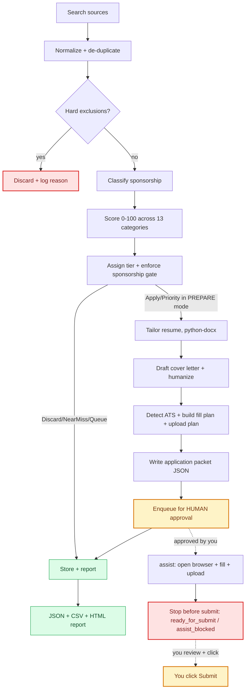

<div align="center">

# Job Agent

Local-first job discovery, deterministic scoring, human-approved applications

   

It finds the roles, scores the fit, tailors the resume, and fills the form.<br>
**You click Submit.**

<sub>DESIGNED AND ENGINEERED BY&nbsp;&nbsp;<b><i>Atresh Somayajula</i></b></sub>

</div>

Every strong match becomes a reviewable **application packet**: the job, its score, a tailored resume, a cover letter, the detected ATS, and a per-field fill plan. Approve one and the agent opens the apply page in a real browser and fills it in. Everything runs on your machine, the dashboard binds to `127.0.0.1`, your profile and screening answers live in gitignored local config, and no credentials leave your disk.

> [!IMPORTANT]
> **The agent fills and uploads, then stops before the final Submit.** There is exactly one automated submit path, and it needs you to opt in *for that specific run*, on a clean form, within a daily cap. Even then a job counts as applied only once the submission is **verified**. Full detail in the [Safety model](#-safety-model).

## 🗺️ Contents

<table>
<tr>
<td width="25%"><b>Start here</b><br><a href="#requirements">Requirements</a> · <a href="#installation">Install</a><br><a href="#first-time-configuration">Configure</a> · <a href="#preflight-check">Preflight</a><br><a href="#your-first-run">First run</a></td>
<td width="25%"><b>Understand it</b><br><a href="#-what-it-does">What it does</a><br><a href="#-the-pipeline">The pipeline</a><br><a href="#-safety-model">Safety model</a> · <a href="#-run-modes">Run modes</a></td>
<td width="25%"><b>Use it</b><br><a href="#-the-dashboard">Dashboard</a> · <a href="#-command-reference">Commands</a><br><a href="#-browser-assisted-apply">Browser assist</a><br><a href="#-chrome--edge-extension">Extension</a></td>
<td width="25%"><b>Tune it</b><br><a href="#-discovery-sources">Discovery sources</a><br><a href="#-performance-notes">Performance</a><br><a href="#-configuration-files">Config</a> · <a href="#-optional-llm-assist">LLM assist</a></td>
</tr>
<tr>
<td colspan="4"><b>Reference</b> · <a href="#-project-layout">Project layout</a> · <a href="#-tech-stack">Tech stack</a> · <a href="#-testing-and-verification">Testing</a> · <a href="docs/SUPPORT_MATRIX.md">Support matrix</a></td>
</tr>
</table>

## 🧭 What it does

<table>
<tr><th width="50%">Find and judge</th><th width="50%">Prepare and hand over</th></tr>
<tr valign="top">
<td><b>1. Finds jobs</b> from public ATS endpoints (Greenhouse, Lever, Ashby, Workday, SmartRecruiters, Workable), aggregator APIs, public JSON-LD pages, and CSV or URL lists you supply.<br><br><b>2. Normalizes and de-duplicates</b> everything into one canonical shape in local SQLite.<br><br><b>3. Excludes</b> the disqualifiers: no sponsorship, clearance required, too junior, wrong employment type, wrong geography, stale.<br><br><b>4. Classifies sponsorship</b> as Confirmed, Likely, or Unconfirmed.<br><br><b>5. Scores 0-100</b> across 13 weighted, config-driven categories.<br><br><b>6. Assigns a tier</b> and applies the sponsorship gate.</td>
<td><b>7. Tailors your resume</b> by emphasizing skills you <i>already have</i>. It never invents one.<br><br><b>8. Drafts a cover letter</b> of 180-260 words, humanized, and only when the job warrants it.<br><br><b>9. Builds a packet</b> holding the detected ATS, the fill plan, screening answers, and the upload plan.<br><br><b>10. Queues it for your approval.</b><br><br><b>11. Assists the apply</b> if you want it to: real browser, fills fields, uploads documents, advances the safe steps, and <b>stops before Submit</b>.</td>
</tr>
</table>

## 🔒 Safety model

This is the one authoritative statement of what the agent will and will not do. Every other section defers to it.

| | Rule |
|:--:|---|
| **1** | **Never bypasses** CAPTCHAs, bot protection, paywalls, login walls, MFA, rate limits, or any other platform security control. |
| **2** | **Prefers official surfaces**: public APIs, RSS feeds, public job pages, ATS endpoints, and URLs you supply. |
| **3** | **No stealth.** No webdriver hiding, no fake user agents, no aggressive scraping. Outbound requests carry a `User-Agent` that names this tool honestly. |
| **4** | **Never fabricates** candidate data. Not resume content, skills, certifications, history, salary, education, or immigration status. |
| **5** | **Human-gated submit.** Search, score, tailor, and fill *planning* are automatic. The final Submit is not. |
| **6** | **Truthful work authorization, always.** The agent will not claim "no sponsorship required." |
| **7** | **Ambiguity comes back to you.** Legal, immigration, salary, and relocation questions pause and ask. |
| **8** | **Every packet is fully reviewable** before anything happens. |

### The submit boundary

The default path never submits. Once it has filled and uploaded everything it can, the runner leaves the job at `ready_for_submit` with the browser open on the final page, or at `assist_blocked` when it needs your input. You review it and click Submit.

<table>
<tr><th width="46%">The one automated path</th><th width="54%">Every gate it has to clear</th></tr>
<tr valign="top">
<td><code>applyRunner.tryAutoSubmit</code><br><br>It exists so a clean, verified, explicitly authorized application can finish without a second trip to the keyboard. Nothing else.<br><br><code>npm run verify</code> asserts these gates are still in place.</td>
<td>✅ You opted in <b>for that specific run</b> (<code>options.autoSubmit === true</code>, and the dashboard asks every time)<br>✅ Zero blockers, every required field filled<br>✅ Truthful sponsorship answers<br>✅ A confidently identified submit button<br>✅ Daily cap not yet reached (<code>MAX_APPLICATIONS_PER_DAY</code>, default 15)</td>
</tr>
</table>

> [!WARNING]
> **A click is not proof.** A job is recorded as submitted only when the runner *verifies* it, meaning a confirmation page or a redirect with the form gone. An unverified click surfaces as `submit_unverified` for you to confirm. It is never quietly counted as an application.

> [!CAUTION]
> **The sponsorship-polarity guard.** Pattern matching cannot tell polarity apart, so a question phrased negatively ("can you work here *without* sponsorship?") is never auto-answered. Inverting the stored answer would amount to guessing about your immigration status. Those questions always come back to you, both at fill time and when you save an answer from the dashboard.

## 🚀 Getting started

### Requirements

| Dependency | Version | Why |
| --- | :---: | --- |
| **Node.js** | **≥ 22.5** | The built-in `node:sqlite` module needs it |
| **Python** | 3.12 | Resume editing through `python-docx` |
| **Playwright Chromium** | *installed by `npm install`* | Browser-assisted form filling |
| MS Word | *optional* | Only for `docx2pdf` PDF export |

### Installation

```bash
npm install                      # Node dependencies + Playwright
pip install -r requirements.txt  # Python dependencies (docx2pdf is optional)
cp .env.example .env             # then edit it. DRY_RUN needs no secrets
```

### First-time configuration

Three things need your input before the first real run.

**1. Your profile.** Copy the templates and fill them in with real information.

```bash
cp config/candidate.example.json config/candidate.json
cp config/screening_answers.example.json config/screening_answers.json
```

Both files are **gitignored**, because they hold your personal data. You can also edit the contact fields from the dashboard under **More ▾ → 👤 Application profile…**

**2. Your master resume.** Put it at `resumes/base/MASTER_RESUME.docx`. It is opened **read-only** and never overwritten, and tailored copies go to `resumes/output/`. From **More ▾ → 🧾 Master resume…** you can read the document's real extracted text, so you see what tailoring actually reads rather than just the filename. You can download it to edit, then upload a replacement. Uploads are validated before they land, so a renamed PDF or a file with no readable text gets refused, and the version being replaced is kept in `resumes/base/history/` for one-click rollback.

**3. Job sources.** The simplest input is a CSV at `data/jobs_input/manual_jobs.csv`:

```csv
source,company,title,location,url,jd_text,posted_at,applicant_count,employment_type
manual,Globex,Lead Data Engineer,"Remote, US",https://boards.greenhouse.io/globex/jobs/42,"Azure Databricks, PySpark, Delta Lake. Visa sponsorship available.",2026-06-02,17,Full-time
```

For live boards, enable sources in `config/jobboards.json`. Keyless cross-company search (`ats-search`) is already on by default, so see [Discovery sources](#-discovery-sources).

### Preflight check

```bash
npm run doctor        # alias: npm run preflight
```

You get one readable checklist covering Node version, SQLite, config schemas, required profile fields, the master resume, Python and `python-docx`, Playwright Chromium, output directory permissions, and test fixtures.

| Result | Meaning |
|:--:|---|
| ❌ **Failure** | Blocks the run |
| ⚠️ **Degraded** | A warning. For example, no Python means an untailored master-resume fallback |
| 📋 **Profile gap** | A field that is genuinely missing, like an empty street address or no GitHub URL |

> [!NOTE]
> Profile gaps are never invented. Fill them in `config/candidate.json` yourself, and only with real information. Add `--json` for machine-readable output. The exit code is 0 only when nothing failed.

### Your first run

<table>
<tr><th width="50%">🖥️ The dashboard (recommended)</th><th width="50%">⌨️ The guided CLI</th></tr>
<tr valign="top">
<td>On Windows, double-click <code>start-dashboard.cmd</code>. It installs dependencies on the first run, starts the server from the right place no matter where you launched it from, and opens your browser once it is ready. Pass a port to override the default, like <code>start-dashboard.cmd 5000</code>.<br><br>On any platform:<br><br><code>npm run app</code> picks a free port, prints the URL, and opens a browser.<br><br><code>npm run dashboard</code> starts the server only, at <code>http://127.0.0.1:4646</code>.</td>
<td><code>npm start</code> runs the whole flow as one interactive session.<br><br>It finds, scores, and prepares in a single pass, lists the prepared packets, and asks which ones to approve. Type <kbd>a</kbd> for all, <kbd>n</kbd> for none, or a range like <code>1,3</code> or <code>1-2</code>.<br><br>Then it offers to open a browser and fill them, stopping before submit. It refreshes the Excel tracker at <code>data/job_tracker.csv</code> along the way.</td>
</tr>
</table>

## 🔄 The pipeline



| Stage | Module | What it does |
| --- | --- | --- |
| **Search** | `src/search/` | Calls public ATS APIs, parses JSON-LD from public job pages, imports your CSV and URL lists. No login automation, no stealth. |
| **Normalize** | `src/search/normalize.js` | Turns every source into one canonical job shape with a stable ID. |
| **De-duplicate** | `src/search/deduplicator.js` | Drops repeats and keeps the richer JD. Skips jobs you have already applied to (`EXCLUDE_ALREADY_APPLIED`). |
| **Freshness** | `src/search/freshnessFilter.js` | Keeps dated postings per `JOB_FRESHNESS_MODE`. Widens to 3 days automatically when a strict window comes back thin (`INCLUDE_LAST_3_DAYS_FALLBACK`). Undated board jobs go to a visible review bucket instead of being dropped quietly (`INCLUDE_UNKNOWN_DATE_JOBS`). |
| **Exclude** | `src/scoring/exclusionFilter.js` | Discards no-sponsorship, clearance, junior or unrelated, wrong-geo, and stale postings. |
| **Sponsorship** | `src/scoring/sponsorshipClassifier.js` | Confirmed, Likely, or Unconfirmed, read from JD phrases plus the known-sponsor list in config. |
| **Score** | `src/scoring/scorer.js` | 13 weighted categories, normalized to 0-100. Fully deterministic. |
| **Tier and gate** | `src/scoring/explainScore.js` | Priority ≥ 85, Apply ≥ 75, Queue ≥ 60, Near miss ≥ 50, then the sponsorship gate. |
| **Tailor resume** | `src/resume/tailor.py` | Bolds the skills you already have that match the JD. Never fabricates. |
| **Cover letter** | `src/apply/coverLetter.js` | Deterministic template, humanized, 180-260 words, written only when warranted. |
| **Packet** | `src/apply/applicationPacket.js` | Bundles job, score, tier, resume, cover letter, ATS, fill plan, and upload plan. Always `submitReady: false`. |
| **Approval** | `src/apply/approvalQueue.js` | Writes the packet as `pending_review`. **This is the compliance choke point.** |
| **Assist apply** | `src/automation/applyRunner.js` | Opens the page, runs guards, fills, uploads, advances the safe steps, stops before submit. |
| **Page guards** | `src/automation/guards.js` | Spots CAPTCHA, login, MFA, and bot walls and forces a stop. It never evades them. |
| **Report** | `src/reports/reportGenerator.js` | Writes JSON, CSV, and HTML summaries to `reports/`. |

<details>
<summary><b>📐 Notable stage behaviors</b>: geography, the fit and sponsorship split, auto-prep scope, two-page discipline</summary>

**Geography.** The US-only gate reads its US signal from `src/utils/usGeography.js`, which covers all 50 states, DC, and the territories by name and by USPS code. So a US city that shares a name with a foreign one, like Dublin OH, Vienna VA, Ontario CA, Athens GA, or Cambridge MA, gets kept. Only a genuinely foreign location is dropped, and anything unknown or ambiguous is always kept for you to judge. C2C, 1099, part-time, and freelance arrangements stay visible and get classified for UI filtering.

**Fit and sponsorship are separate measurements.** The gate downgrades Apply and Priority to Queue unless sponsorship is acceptable or you approved it, but the dashboard still shows those gated 75+ roles as **strong fits** with a "⚠ verify sponsorship first" action. Fit measures how well the *role* matches. Sponsorship feasibility is reported next to it. The gate only blocks auto-preparation.

**Auto-preparation scope.** Only Priority and Apply tiers get prepared automatically. Queue-tier jobs are prepared only when you pick them yourself with "Prepare selected".

**Two-page resume discipline.** The tailor repairs layout artifacts like manual page breaks, merged role blocks, and blank filler, then holds the result to two pages by dropping whole low-relevance bullets from the oldest roles. It never shortens or rewords a claim, and never drops a role, its dates, or its last bullet. Whatever it omitted is listed for review. There is an optional per-job "Most relevant to this role" focus line, but it is **off by default** (`config.runtime.resumeFocusLine === true`).

</details>

## 🔀 Run modes

Valid modes are **`DRY_RUN`**, **`PREPARE`**, and **`LIVE_ASSIST`**, set through `RUN_MODE` or `--mode`. Anything unknown or legacy falls back to `DRY_RUN`.

| Phase | Command | Behavior | Browser? |
| --- | --- | --- | :---: |
| **Discover** | `npm run discover` | Search only, writing `data/found_jobs.json` with every job and what happened to it. No scoring, no secrets. | |
| **Score** | `npm run score` | Search and score, writing `scored_jobs.json` and `queued_jobs.json`. No packets. | |
| **Prepare** | `npm run prepare-apps` | All of the above, plus resume tailoring, cover letters, packets, and the approval queue. | |
| **Assist** | `npm run assist` | Opens **approved** packets in a real browser, fills and uploads, advances the safe steps, stops at `ready_for_submit`. | ✅ |
| **End-to-end** | `npm run end-to-end` | `prepare-apps` then `assist`, stopping at the human-approval boundary. | ✅ |

> [!NOTE]
> Unattended auto-submit is deliberately not possible. Submission happens when you click Submit, or when you opt in to auto-submit for a specific run, and even then only verified submissions get recorded. See the [Safety model](#-safety-model).

## 📊 The dashboard

A local-only web cockpit that binds to `127.0.0.1`, needs no extra dependencies, and drives the whole workflow from the browser. It is built as a dense one-page daily workbench: workflow tabs and the job table hold the main column, priorities and the selected-job inspector hold the right column, and documents, analytics, settings, and run RCA open as utility drawers rather than replacing the workbench.

<details open>
<summary><b>📋 Board and filtering</b></summary>

- **Tiles** for jobs tracked, discovered today, posted in the last 24h, strong, medium and weak fit, shortlisted, pending review, prepared today, ready to submit, submitted today, blocked, and rejected. Each tile filters the board, and **a tile's count always equals the rows its filter opens**.
- **Board** with search, filters, sorting by grade, company or newest, and side-by-side comparison of up to three jobs. Filters sit in two visible lanes: search, fit, status, posting age and remote on the first, then sponsorship, job type, source, ATS, resume state and closed jobs on a quieter second lane. **Nothing hides behind a dropdown**, so a filter can never narrow the board out of sight. Every applied filter also shows up as a chip you can clear on its own.
- **Nationwide coverage, stated as data.** Every configured search asks for the whole United States, and the header shows how many of the **56 US states and territories** the open board actually spans, with a per-state breakdown under "Where the jobs are".

</details>

<details>
<summary><b>📄 Documents and answers</b>: master resume, application profile, the answer-once queue</summary>

- **Master resume** under **More ▾ → 🧾 Master resume…** lets you read the real extracted text, download it to edit, upload a validated replacement, and roll back in one click.
- **Application profile** under **More ▾ → 👤 Application profile…** holds the name, contact details, and links the form filler types on every application, edited in the browser instead of by hand in `config/candidate.json`. Every save is validated against the config schema before it lands, keeps the previous version, and gets picked up by the next run without restarting the dashboard. **Only the fields the filler can actually use are editable**, so a save can never blank out the work history and skills that tailoring and scoring depend on.
- **Answer a question once, not every time.** When a live form asks something the screening matcher cannot answer, the run stops for you, and the question lands in a queue on that same page along with the jobs that asked it and how often. Answering it there writes a validated entry into `config/screening_answers.json`, so every future application asking the same thing fills it in automatically. **Coverage only grows.** The truthfulness rules apply at save time exactly as they do at fill time, so an answer that would misstate work authorization gets refused, including an innocuous-looking "Yes" to a reversed sponsorship question. A count of what is waiting shows in the header's health strip.

</details>

<details>
<summary><b>💡 Insight and action</b>: why it fits, the verify-sponsorship queue, pipeline runs, audit trail</summary>

- **Why it fits.** Every job shows its score explanation, the JD skills you have, and the JD skills not evidenced in your profile. A skill-alias ontology (`config/scoring.json` → `evidenceAliases`) keeps those two lists consistent, so "ADF" in a JD is evidenced by "Azure Data Factory" in your profile, and "lakehouse" by "Delta Lake" or "Databricks".
- **Verify sponsorship queue.** Strong-fit roles at 75 or above with unverified sponsorship get a "verify" chip plus their own tile and next action, rather than disappearing into the medium bucket. The safety gate still keeps them out of auto-preparation until you confirm.
- **Actions**: shortlist, reject, archive, approve packet, *Fill in browser (stops before submit)*, and *I submitted it myself*, which is **the only path to "submitted"**. The system will never set that on its own.
- **Pipeline buttons.** Discover, Score, and Find & Prepare run the real pipeline in the background. A run shows live in the header as a progress pill telling you what it is doing, how many of how many boards are done, which board is current, elapsed time, and a determinate progress line. **Details** opens the per-board breakdown of found counts, errors, duration, and cache hits, and when something failed it shows the *cause*: failure category, HTTP status, the provider's own message, and what to do about it. Results stay until you dismiss them.
- **Breakdowns** for found, strong, prepared and submitted per source; Confirmed, Likely and Unconfirmed sponsorship counts with how many of each are strong fits; and discovered, prepared and submitted per day for the last 7 days.
- **Next actions**, a ranked to-do list covering filled apps waiting for your Submit, packets awaiting approval, blocked apps, strong fits with no decision, and unconfirmed posting dates. Each one links to the filtered board view.
- **Audit trail** showing every recorded event for a job (scored, prepared, assisted, blocked) in the detail panel, plus the last assisted-fill result with fields filled and blockers.

</details>

Change the port with `--port=NNNN` or `DASHBOARD_PORT`. The dashboard enforces the same safety gates as the CLI.

## 🤖 Browser-assisted apply

The agent does the thinking deterministically first and hands you a finished packet.

<table>
<tr><th width="50%">Before the browser opens</th><th width="50%">What <code>npm run assist</code> then does</th></tr>
<tr valign="top">
<td><b>Detects the ATS</b>, whether Greenhouse, Lever, Workday, iCIMS, Taleo, SmartRecruiters, Jobvite, or generic, from the URL and markup.<br><br><b>Builds a fill plan</b>, an explicit list of <code>field label → value → CSS selector → source</code> entries drawn from your profile and configured screening answers. Each platform adapter knows that ATS's common field selectors.<br><br><b>Builds an upload plan</b> that confirms the tailored resume, and the optional cover letter, exist and are valid file types.<br><br><b>Marks every plan</b> <code>submitReady: false</code> and <code>stopBeforeSubmit: true</code>.</td>
<td><b>1.</b> Opens the apply page and runs <b>page guards</b>. On a CAPTCHA, login wall, MFA prompt, or bot-protection page it <b>stops</b> and leaves the browser open for you. It never tries to solve or evade any of them.<br><br><b>2.</b> Fills only the fields it can resolve confidently. Unknown screening questions become <b>blockers</b>.<br><br><b>3.</b> Uploads the tailored resume and cover letter to the file inputs.<br><br><b>4.</b> Clicks only <b>safe navigation</b> (Next, Continue, Review) to advance multi-step forms, and <b>stops before the final Submit</b>.</td>
</tr>
</table>

<details>
<summary><b>🧷 Durable checkpoints and the eligibility gate</b></summary>

Auto-Apply is off by default and needs explicit one-run authorization in the eligibility preview. The server re-runs every check immediately before opening a browser.

A job is **excluded** when it is already applied, duplicated, rejected, archived, missing a prepared packet or resume, carrying unresolved screening questions or upload blockers, requiring unsafe sponsorship answers, sitting on an unsupported ATS, or lacking a valid application URL.

Checkpoints distinguish `precheck`, `filling`, `review`, `ready`, `submitting`, `verifying`, `user_submitted`, `verified`, `blocked`, `failed`, and `cancelled`. **Submission-attempt phases cannot quietly reopen and submit again.** Failed or cancelled pre-submission work resumes from saved completed fields.

</details>

## 🧩 Chrome / Edge extension

The unpacked Manifest V3 extension in `extension/` moves an approved job from its posting to the real application and fills the current form step **inside your normal signed-in Chrome or Edge profile**.

| | Step |
|:--:|---|
| **1** | Start the dashboard with `npm run dashboard` |
| **2** | Open `chrome://extensions` or `edge://extensions`, turn on **Developer mode**, choose **Load unpacked**, and select this repository's `extension` folder |
| **3** | Open the extension's **Connection settings**. Keep the server at `http://127.0.0.1:4646` and paste the value of `JOB_AGENT_EXTENSION_KEY` from your local `.env` |
| **4** | Prepare and approve a job in the UI, select its row, and click the extension. The selected ID transfers automatically through the dashboard URL, so there is nothing to copy and paste |
| **5** | Choose **Open application**. On LinkedIn, Indeed, or an employer job page, choose **Start / fill application**. It starts the application when it needs to, or fills the visible form step and attaches the approved resume. Review it, continue, and run it again on later ATS steps |

> [!IMPORTANT]
> **You always click the final Submit yourself.**

<details>
<summary><b>🛡️ Security boundaries</b></summary>

- The server stays **loopback-only**.
- Extension requests require the **high-entropy shared key** and reject cross-site browser traffic.
- **Only approved packets** are readable, artifact paths have to stay inside the repository, and already-submitted jobs are blocked.
- The extension gets **no permanent website access**, only `activeTab`.
- Job context is **verified before** any navigation or filling.
- It never fills passwords, CAPTCHAs, voluntary demographic fields, legal attestations, or submit controls.

Rotate the key if it is ever exposed, and restart the dashboard afterwards.

</details>

## 🌐 Discovery sources

### Two kinds, and why you need both

| | 🏢 Company-first | 🔍 Query-first |
| --- | --- | --- |
| **Sources** | Greenhouse, Lever, Ashby, SmartRecruiters, Workday, careers pages | `ats-search`, `adzuna`, `apify` |
| **You configure** | a list of **boards** | a list of **titles** |
| **Finds** | everything at those employers | matching roles at employers **you have never heard of** |
| **Cost** | free, unmetered | free (`ats-search`), metered (`adzuna`, `apify`) |

Company-first sources hand back an employer's *entire* requisition list, so only a small fraction is ever on-target. They give you depth, not reach. Query-first sources give you reach. The two feed each other: query-first turns up new employers, and `scripts/harvestSources.mjs` promotes those employers into permanent company-first board entries.

### Keyless cross-company search (`ats-search`)

> [!TIP]
> **Enabled by default, no API key, no per-run cost.** This is the source that makes discovery work out of the box.

It searches across *every* employer hosted by an ATS vendor rather than one configured board at a time.

| Vendor | Endpoint | Behavior |
| --- | --- | --- |
| **Workable** | `jobs.workable.com/api/v1/jobs` | Real pagination, and the full job description arrives **inline**, so no follow-up request is needed |
| **SmartRecruiters** | `jobs.smartrecruiters.com/sr-jobs/search` | The newest 100 matches per query, since the server ignores `offset`, with optional budgeted full-JD enrichment |

Queries default to `targetTitles` from `config/candidate.json`, so the title list lives in exactly one place. Both vendors **OR-match** query terms, meaning a bare "data engineer" search returns anything containing "data" *or* "engineer". Queries are therefore phrase-quoted, and every hit has to clear a title gate. SmartRecruiters also ignores every country parameter, so US-only filtering is enforced client-side.

<details>
<summary><b>⏱️ Two freshness controls, and the measurements behind them</b></summary>

A cross-company index keeps requisitions nobody ever closed, and a dead posting matches on title just as well as a live one.

| Control | Default | Purpose |
| --- | :---: | --- |
| **`dayRange`** | 7 | Bounds the Workable request server-side. Workable ranks by **relevance** and offers no sort parameter, so this is the only recency lever, and raising it *displaces* fresh jobs rather than adding old ones, because relevance spends a fixed page budget on a larger corpus. **Measured:** `dayRange=7` returned 137 jobs under a week old, while `dayRange=30` returned only **76**. |
| **`maxAgeDays`** | 180 | A hard ceiling on both providers, and deliberately loose. It is a **zombie guard, not a freshness filter**, because real requisitions stay open for months. Undated postings are kept, not assumed stale. |

Without them the adapter returned postings **up to 12 years old**, and 89% of the SmartRecruiters rows were over a year old. With them, **median age is 5.5 days**.

Both endpoints are the unauthenticated JSON that the vendor's own public job-search site calls. No login, no CAPTCHA solving, no evasion. See [`docs/SUPPORT_MATRIX.md`](docs/SUPPORT_MATRIX.md) for the per-host robots.txt notes.

</details>

### Workday searches what your profile says

Workday's public feed is a search endpoint, so something has to get typed into it. That used to be the literal string `"data engineer"` pasted onto every tenant, which meant adding a title to `candidate.json` changed nothing and BI or ETL roles stayed invisible.

Phrases now get derived from `candidate.targetTitles` by `deriveSearchTerms`. Given 17 titles it produces `["data engineer", "bi developer"]`, which is **the fewest two-token phrases such that every target title shares a word with one of them**. Change your titles and every board follows, with no per-tenant edit.

> [!NOTE]
> **Two tokens, not longer**, because Workday's search *narrows* as words get added. Measured on one tenant: `data` gave 115 hits, `data engineer` gave 51, and a nine-word phrase gave **0**. Override with `searchTexts`, or cap cost with `maxSearchTerms`.

<details>
<summary><b>📡 Aggregator discovery via Adzuna</b>: optional, free key, roughly 1,000 calls a month</summary>

An official aggregator API, and the closest keyed substitute for Apify's breadth. Register free at <https://developer.adzuna.com/>, put `ADZUNA_APP_ID` and `ADZUNA_APP_KEY` in `.env`, then confirm the key:

```bash
node scripts/adzuna-check.mjs
```

That validates your credentials against the live API **and runs the real adapter for one query**, so you see actual mapped jobs before trusting it. Once the key is present, `adzuna-aggregator` is enabled by default.

**Verified live on 2026-08-01.** That same run exposed something worth knowing: `what_phrase` matches anywhere in the posting **body**, not just the title, so a bare "Data Engineer" query came back with **31,148 hits**, plenty of them unrelated roles. The same client-side title gate `ats-search` uses filters this out. Disable it with `options.strictTitleMatch: false` if it ever drops something you wanted.

</details>

<details>
<summary><b>🐙 Multi-portal discovery via Apify</b>: optional, metered, covers LinkedIn, Indeed, Glassdoor, Google Jobs</summary>

To discover from LinkedIn, Indeed, Glassdoor, and Google Jobs without writing scrapers, use the **Apify** source. It calls the official Apify API with *your* account token and runs maintained actors from the [Apify Store](https://apify.com/store), mapping their output into the same normalized shape every other source uses.

**1.** Create a token at <https://console.apify.com/account/integrations> and set `APIFY_TOKEN=...` in `.env`.

**2.** In `config/jobboards.json`, enable the `apify-scrapers` source and list actors:

```jsonc
{
  "id": "apify-scrapers",
  "adapter": "apify",
  "enabled": true,
  "priority": 2,
  "options": {
    "tokenEnv": "APIFY_TOKEN",
    "maxItemsPerActor": 100,
    "actors": [
      {
        "actorId": "bebity~linkedin-jobs-scraper",   // username~actor-name from the Store
        "label": "linkedin",
        "source": "linkedin",
        "input": { "title": "Senior Data Engineer", "location": "United States", "rows": 50 }
        // "fieldMap": { "title": "positionName", "url": "jobUrl" }  // optional overrides
      },
      { "datasetId": "your-existing-dataset-id" }       // OR: read a previous run's results
    ]
  }
}
```

The adapter auto-detects the common output fields most job actors use (`title` or `positionName`, `companyName`, `location`, `url` or `jobUrl`, `descriptionText`, `postedAt`, and so on). Add a per-actor `fieldMap` when an actor differs. The token goes out as an `Authorization: Bearer` header, **never in a URL**, and actor failures are isolated so one bad actor never crashes a run. Jobs found this way carry real apply URLs, so `assist` can navigate to and fill the actual application.

**Cost and the monthly allowance.** Running an actor spends real money on your Apify account, while reading a saved `datasetId` does not. Retries reflect that, so only a `429` gets retried, because it was rejected at the gate and nothing was charged. Re-running a timed-out `run-sync` call would pay for the same scrape twice.

Once the plan's monthly limit is reached, Apify rejects every new actor run. So the adapter makes **one free usage check before starting anything**, and if the allowance is spent it skips the actors entirely and reports a single line naming the numbers and the reset date. The alternative was firing all 25 configured actors at a wall and reporting 25 identical rejections with no cause. Other sources are unaffected. The free plan's **$5 a month** allowance can be spent in a day or two by a full nationwide sweep.

**Apify is not a single point of failure any more.** It used to be the only query-first source, so exhausting that $5 quietly switched off the entire on-target top of the funnel while the company-first boards kept returning thousands of irrelevant roles and **made coverage look healthy**. `ats-search` now provides keyless query-first discovery unconditionally, and `harvestSources` converts whatever Apify *does* find into permanent free board coverage. Treat Apify as reach you top up, not as infrastructure.

</details>

### Growing the board list automatically

Every job URL you have already seen names the ATS board it came from. `harvestSources` mines them, verifies each one against that vendor's public API, and adds the live ones to `config/jobboards.json`:

```bash
node scripts/harvestSources.mjs                          # dry run, report only
node scripts/harvestSources.mjs --apply                  # write, after taking a backup
node scripts/harvestSources.mjs --apply --limit=25 --min-jobs=2
```

Board enumeration is free and unmetered forever after, so **each harvested coordinate converts a one-off metered lookup into permanent free coverage**. Run it occasionally, since it is the mechanism that makes discovery compound instead of resetting every time a paid provider's quota does.

## ⚡ Performance notes

### The fast "what's new today?" sweep

A full sweep of roughly 492 boards takes about **14 minutes**, which is right for a daily catch-all and far too slow for the question you actually ask most often. Scope a run to one source:

```bash
npm run score -- --source=adzuna       # ~30s, fresh aggregator jobs onto the board
npm run score -- --source=adzuna,ats-search
npm run score -- --free-only           # everything except metered Apify
```

`--source=` matches a source `id` **or** an `adapter` name, comma-separated. It only ever *narrows*, so naming a source that is disabled in `config/jobboards.json` will not switch it back on, and a selector matching nothing warns you instead of quietly sweeping everything.

> [!TIP]
> Use `score`, not `discover`. `discover` only writes `data/found_jobs.json`, while `score` discovers, scores, **and persists to the board**.

<details>
<summary><b>🔧 Workday concurrency, and why <code>boardConcurrency</code> is the wrong knob</b></summary>

Workday dominates a full sweep, and the reason is not what it looks like. Workday tenants are **not independent hosts**. `hostKeyFor` deliberately collapses `nvidia.wd5…` and `citi.wd5…` onto the shared pod `wd5.myworkdayjobs.com`, because that is where Workday actually throttles. **87 of the configured tenants sit on `wd1` alone**, all sharing one gate.

That makes `boardConcurrency` almost inert here, since raising it does nothing while the pod gate is the binding constraint. The knobs that matter are **`hostConcurrency`** and **`hostSpacingMs`** on the `workday-public` source.

| Setting | Result |
| --- | --- |
| 500ms spacing | Every tenant on a pod pinned to a combined **2 requests/second**, which was a 10-minute floor |
| No spacing, 8 in flight | **5.1x faster, zero throttling** |

If a pod ever starts returning 429s, the gate's Retry-After handling and circuit breaker back off on their own. Full probe data lives in [`docs/SUPPORT_MATRIX.md`](docs/SUPPORT_MATRIX.md).

</details>

### Watch mode and cancellation

Watch mode polls every `WATCH_INTERVAL_MINUTES`, default 20. With a large board list, either keep that above your run time or use `--free-only` against a trimmed config.

Cancelling is immediate, measured at about **120ms**. In-flight requests abort and queued work gets dropped, while everything already found is kept.

## 💻 Command reference

### One command (recommended)

```bash
npm start                     # interactive: find, score, prepare, approve, fill
npm start -- --yes            # auto-approve every prepared packet, then fill
npm start -- --prepare-only   # find, score, prepare, then stop at the approval gate
npm start -- --no-assist      # approve, but don't open the browser
```

> [!IMPORTANT]
> `--yes` only auto-***approves*** and fills the forms. **Nothing gets submitted automatically.** You review and submit each one yourself.

### Pipeline phases

Prefer `npm start` above. These are for running a single phase.

```bash
npm run discover       # search only          -> data/found_jobs.json
npm run score          # + score              -> scored_jobs.json + queued_jobs.json
npm run prepare-apps   # + tailor + packets   -> applications/output/ + approval queue
npm run assist         # open browser + fill, STOP before submit
npm run end-to-end     # prepare-apps then assist (stops at approval boundary)
npm run watch          # poll on an interval
```

### Human approval workflow

```bash
npm run approvals          # list packets awaiting your review
npm run packets            # list prepared packets (company, score, tier, blockers)
npm run packet -- <id>     # show one packet in full (by job id or packet id)
npm run approve -- <id>    # record YOUR approval for a packet
npm run reject -- <id>     # reject a packet
```

> [!NOTE]
> The `--` is required so npm passes the id through, as in `npm run approve -- 8aedd008-aebe-40d0-b48f-4a61490a8730`.

### Utilities and diagnostics

```bash
npm run app            # canonical launcher (dashboard + browser + port fallback)
npm run dashboard      # dashboard server only
npm run doctor         # preflight checks (env, config, resume, browsers, dirs)
npm run report         # regenerate reports from stored data
npm run verify         # repo health + safety check (asserts submit stays human-gated)
npm run db:maintenance # checkpoint the SQLite WAL (+ --vacuum to compact)
npm run tracker        # refresh the Excel tracker at data/job_tracker.csv
npm test               # Node test suite (vitest)
npm run test:py        # Python test suite (pytest, needs `python` on PATH)
```

<details>
<summary><b>🧰 Maintenance scripts, and a typical phase-by-phase session</b></summary>

```bash
node scripts/harvestSources.mjs               # grow the board list from seen job URLs
node scripts/adzuna-check.mjs                 # validate the Adzuna key against the live API
node scripts/relabelUndatedJobs.mjs           # report rows mislabelled "stale: unknown posting date"
node scripts/relabelUndatedJobs.mjs --apply   # relabel them as "unknown posting date"
node scripts/dbMaintenance.mjs --vacuum       # compact the SQLite store
pip install -r requirements-llm.txt           # ONLY if you enable LLM_ASSIST
python test_api_key.py                        # check the LLM key/endpoint (reads env only)
```

A typical phase-by-phase session:

```bash
npm run prepare-apps       # build + queue packets for strong matches
npm run packets            # see what's queued
npm run packet -- <id>     # review one in detail
npm run approve -- <id>    # approve the ones you want
npm run assist             # browser fills the approved forms, stops before submit
# ...you review the filled form in the open browser and click Submit yourself.
```

A `prepare-apps` run prints a `cover_letter_generated` and an `approval_required` log line per strong match, and writes the packet to `applications/output/`.

</details>

## 🧠 Optional LLM assist

> [!NOTE]
> **Off by default.** Turn it on with `LLM_ASSIST=on` plus an API key, described in `.env.example`. It is deliberately confined to one narrow, verifiable job.

**The problem it solves.** The deterministic tailor can only recognize requirements that already appear in `config/scoring.json`'s keyword vocabulary. A posting asking for "dimensional modeling", "Iceberg", or "dbt exposures" surfaces nothing if those terms were never listed, so the resume never gets reordered to answer them and they never get reported as gaps. Hand-maintaining that vocabulary across every employer's phrasing does not scale.

**What it does.** The model reads the job description and proposes requirement phrases. That is all it does.

> [!IMPORTANT]
> **Why it cannot fabricate.** Every proposed phrase is checked to occur **verbatim in that job description** before it gets accepted. A phrase the model invented cannot survive that check, so hallucination is blocked by the structure rather than just discouraged. Rejected phrases are counted and shown in the packet.

**What it never touches.** It does not write, reword, or suggest resume prose. Accepted phrases go to the same deterministic tailor, which only reorders and emphasizes text already present in your master resume and reports everything else as an honest gap. Free-form resume rewriting stays disabled, and the module docstring in `src/resume/tailor.py` explains why.

**Privacy boundary.** Only the public job description and title get sent. Your resume, contact details, EEO answers, and salary expectations are never transmitted.

**Other guarantees.** It is never consulted on the auto-submit path. It runs deterministically at `temperature: 0` and gets cached by content hash, so re-preparing a job is free and its audit trail is reproducible. Disabled, offline, slow, or malformed responses all fall back quietly to the deterministic path.

| Layer | Who decides | Can it invent? |
| --- | --- | --- |
| JD requirement extraction | LLM proposes, grounding check verifies | **No.** Unverifiable phrases get dropped |
| Resume content selection | Deterministic tailor | **No.** It only reorders existing text |
| Gap reporting | Deterministic tailor | **No.** It reports what is missing and adds nothing |
| Screening answers | Your `config/screening_answers.json` | **No.** The LLM is not involved |
| Final submit | **You** | n/a |

## 📑 Configuration files

> [!IMPORTANT]
> **Config, not source code, is authoritative.** Scoring weights, exclusions, screening answers, and profile values are never hardcoded. Every file gets schema-validated at load, against `config/schemas/`.

| File | Contents |
| --- | --- |
| `config/candidate.json` | Your profile, skills, target titles, work authorization. 🔒 **Gitignored**, so copy `candidate.example.json` |
| `config/screening_answers.json` | Truthful, pattern-matched answers to form questions. 🔒 **Gitignored**, so copy `screening_answers.example.json` |
| `config/scoring.json` | Weights, tiers, keywords, sponsorship signals, `evidenceAliases` |
| `config/exclusions.json` | Hard disqualifier phrases |
| `config/jobboards.json` | Which sources are enabled, and how they are tuned |
| `config/cover_letter.json` | Cover-letter template and thresholds |
| `config/humanizer_patterns.json` | Banned phrases and characters to strip |
| `.env` | 🔒 Secrets only. Never committed |

## 📁 Project layout

```
config/           validated config files + JSON schemas (the source of truth)
src/              Node + Python modules
  index.js          CLI entry point
  cli/              phase commands, guided flow, doctor, watch
  pipeline/         run orchestration across all phases
  search/           source adapters, normalization, dedupe, freshness
  scoring/          exclusions, sponsorship classifier, scorer, tier gate
  resume/           Python tailoring, audit, humanizer, pdf
  apply/            cover letter, application packet, approval queue, screening Q&A
  automation/       Playwright assist runner, page guards, field filler
  dashboard/        local web workbench (server + static assets)
  extension/        server-side endpoints backing the browser extension
  reports/          JSON / CSV / HTML report generation
  llm/              optional JD requirement extraction
  logging/          SQLite store + pino structured logs
  utils/            shared helpers (geography, paths, retry, rate limiting)
scripts/          maintenance and diagnostic tools
extension/        unpacked Manifest V3 Chrome/Edge extension
resumes/
  base/             master resume (read-only) + history/
  output/           tailored drafts + cover letters
applications/
  output/           one JSON application packet per prepared job, and these are what you review
data/
  jobs_input/       your manual_jobs.csv
  found_jobs.json   every discovered job + its lifecycle status
  scored_jobs.json  every scored job (tier + sponsorship breakdown)
  queued_jobs.json  only actionable jobs (Priority/Apply/Queue)
  unknown_date_review.json  undated jobs held for manual review (opt-in)
  applied_jobs.db   local SQLite store (jobs, runs, events, approval queue)
reports/          report-YYYYMMDD.json / .csv / .html
logs/             structured JSON run logs
tests/            node/ (vitest) and python/ (pytest)
docs/             SUPPORT_MATRIX.md, the evidence-backed capability statement
```

> [!NOTE]
> Each packet in `applications/output/` is **the artifact you review**. It holds the job, the score and tier, the tailored resume path, the cover letter path, the detected ATS, the per-field fill plan, the upload plan, and any blockers or questions needing your input.

## 🧱 Tech stack

| Layer | Technology |
| --- | --- |
| Orchestration, connectors, scoring, form-prep | **Node.js 22.5+** |
| Resume editing, audit, tailoring | **Python 3.12 with python-docx** |
| Storage | **SQLite** through the built-in `node:sqlite`, so no native build step, and not `better-sqlite3` |
| Browser assist | **Playwright** driving real Chromium, with page guards, stopping before submit. Never used to scrape or evade |
| Supporting | **dotenv** for secrets, **pino** for structured JSON logs, **ajv** for config validation |
| Testing | **vitest** for Node, **pytest** for Python |

## ✅ Testing and verification

```bash
npm run verify     # repo health + safety gates (asserts submit stays human-gated)
npm run doctor     # environment preflight
npm test           # Node suite (vitest)
npm run test:py    # Python suite (pytest)
```

<div align="center">

**Current baseline, verified on 2026-08-16**<br>


</div>

Run-level failures and partial source failures show up in the Activity/RCA drawer with sanitized symptoms, likely cause, retry guidance, retryability, and whether partial results are still valid. **Secrets and screening answers never appear** in those entries.

### Capability honesty

[`docs/SUPPORT_MATRIX.md`](docs/SUPPORT_MATRIX.md) is the authoritative, evidence-backed statement of what works. Its distinctions matter:

| Mark | Means |
| --- | --- |
| **Fixture-tested** | A vitest suite drives the capability against local fixtures. **Never a live site, never a real application.** |
| **Manually verified** | A human confirmed it against a live site at least once. **If that mark is absent, it has not been verified live.** |
| *Unlisted* | Unsupported. The agent stops safely and reports RCA rather than guessing |

<details>
<summary><b>📋 Coverage summary</b>: discovery, auto-fill, and verified auto-apply per source</summary>

| Source / ATS | Discovery | Auto-fill | Verified auto-apply | Key limits |
| --- | --- | --- | --- | --- |
| **Greenhouse, Lever, Ashby** | Official public APIs | Fixture-tested | Eligible once all gates pass | Live per-ATS submission is not manually verified |
| **SmartRecruiters** | Official public endpoints | Fixture-tested | Same fail-closed gate | Tenant-specific fields can need review |
| **Workday** | Configured public CXS endpoints | Fixture-tested multi-step | Same fail-closed gate | Tenant schemas vary. Auth, CAPTCHA and MFA are never bypassed |
| **Generic company pages** | JSON-LD or manual URL | Conservative field matching | Same fail-closed gate | Unknown or required fields stop for review |
| **LinkedIn, Indeed, Dice** | Provider results plus manual URLs | Only once it reaches a supported external form | ❌ **Not eligible** on protected marketplace pages | No login-wall, CAPTCHA, rate-limit or anti-bot bypass |
| **iCIMS, Taleo, Jobvite** | Manual or direct URL workflows | Best effort | ❌ **Not in the allowlist** | Review and submit manually |

</details>

> [!WARNING]
> The product **never treats a clicked Submit button as proof of application.** `applied=1` requires positive confirmation evidence, meaning a confirmation page or a confirmation number. A browser close, an ambiguous response, or a validation failure stays **resumable and unverified**.

## 📌 Project status

**All phases complete**, including the browser-assisted apply layer, a production-hardening pass, and a data-quality audit pass.

| | Phase | Scope |
|:--:|---|---|
| ✅ | **1** Scaffold | Directories, config, schemas, project metadata |
| ✅ | **2** Config and utilities | Loaders, validation, rate limit, retry, credentials, notifier, text, dates |
| ✅ | **3** Storage and observability | Database (`node:sqlite`), logging (pino), report generator |
| ✅ | **4** Search and normalization | Official ATS APIs, public-page JSON-LD, dedupe |
| ✅ | **5** Filtering and scoring | Exclusions, sponsorship classifier, scorer, explain and tier gate |
| ✅ | **6** Document generation | Resume tailoring in Python, cover letter in JS |
| ✅ | **7** Packets and approval | Application packet, approval queue, ATS detection, screening Q&A, form-prep platforms |
| ✅ | **8** Runner and CLI | DRY_RUN, PREPARE and LIVE_ASSIST modes |
| ✅ | **9** Verification | End-to-end dry run and prepare run verified |
| ✅ | **10** Lifecycle | Lifecycle statuses, clean output artifacts, runtime resume tailoring |
| ✅ | **11** Browser automation | Guards, field resolver, upload runner, assist apply runner, approval CLI |

<div align="center">

### Designed and Engineered by ***Atresh Somayajula***

<sub>Built for a senior data engineer profile that requires visa sponsorship.<br>Local-first, deterministic, and human-authorized by design.</sub>

</div>
